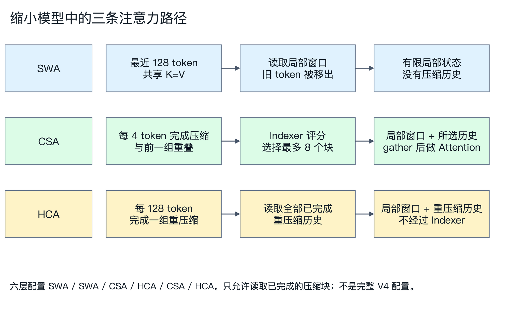
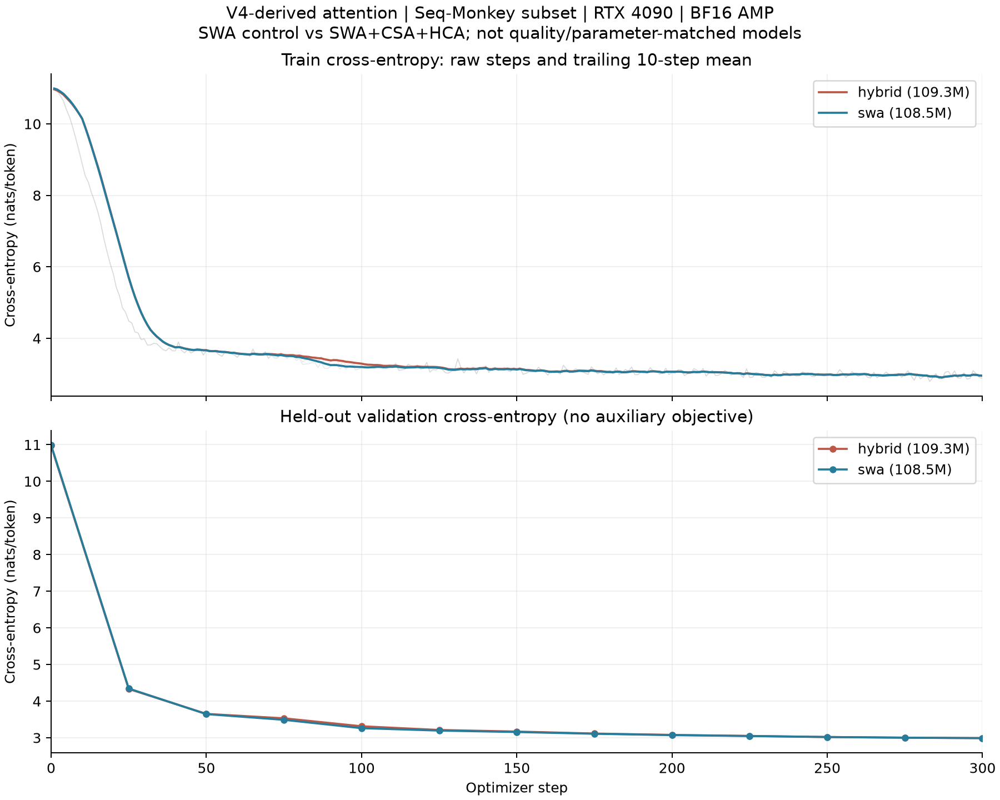
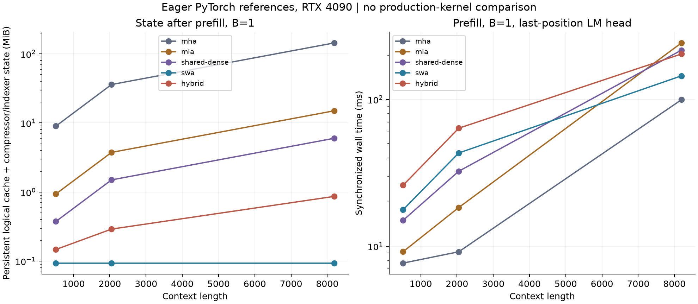
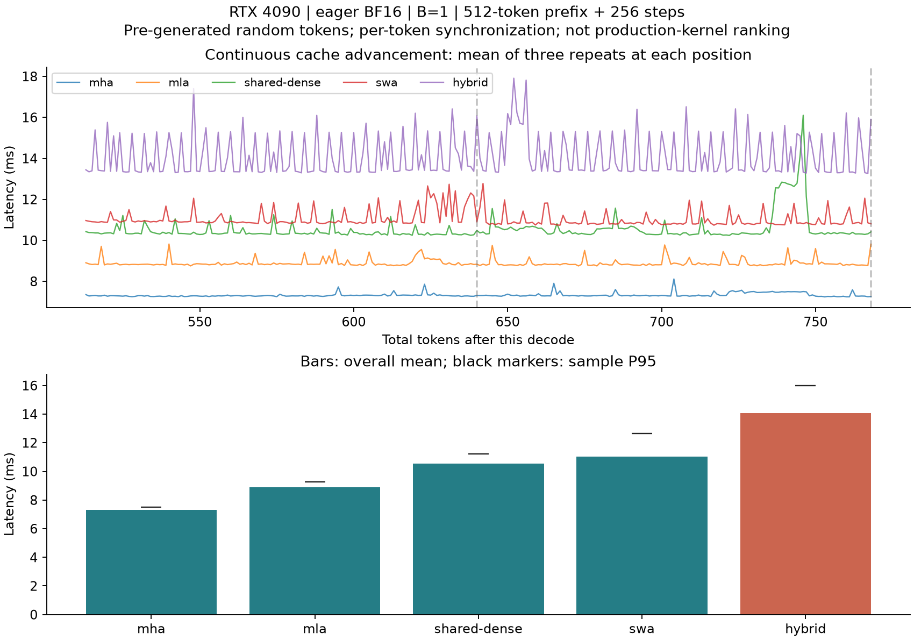
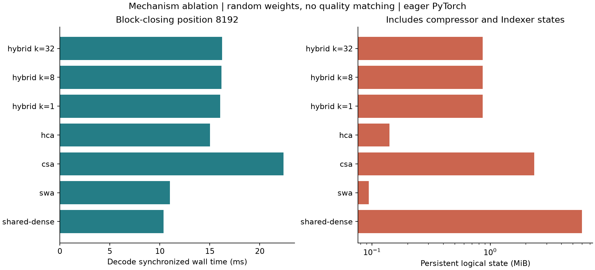
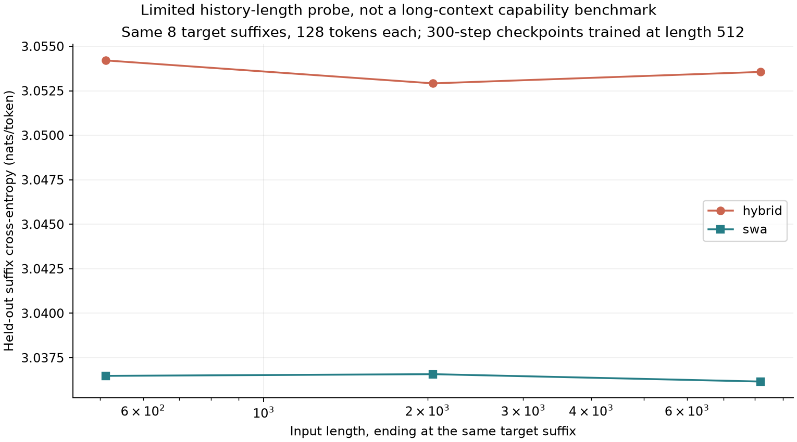

# 从大模型到 AI 芯片 三 Hybrid Attention 如何改变计算与访存

上一篇讨论 MLA 时，出现了一个很直观的结果：缓存容量降了，普通 PyTorch 实现却没有更快。再往下看 Hybrid Attention，这个问题会更明显。模型不仅要保存历史，还要一边生成，一边决定历史怎样压缩、哪些内容值得读回来。

这也是我想从模型侧回看 AI 芯片的原因。工作负载变了，芯片面对的就不只是更小的 QK 矩阵。压缩器要更新状态，Indexer 要评分和选择，后面还有 gather、Softmax 和输出投影。它们的数据规模、出现频率和访问方式，与一块规整的大 GEMM 不太一样。

这篇将这些步骤拆出来，在小模型上核对计算、跑短程训练，再测缓存与延迟。先说结果：状态确实能明显缩小，但在这份未融合的参考实现中，额外步骤的开销也很明显。至于长上下文效果，现有短程训练还不足以下结论。

## 一 固定的 Hybrid 结构

Hybrid Attention 是一类混合设计的统称，不是某一种确定的算法。这里固定参考 DeepSeek-V4-Flash 的 SWA、CSA 和 HCA，源码 revision 为 60d8d70770c6776ff598c94bb586a859a38244f1，对应技术报告第 2.3 节。

我没有加载完整 DeepSeek 模型，而是把注意力结构缩小，接到前两篇的 Dense 主干上：6 层、隐藏维 768、12 heads、head dim=64、SwiGLU 中间维 2048，词表仍为 50257。使用普通残差与 AdamW，不含 MoE、mHC、MTP、Muon 或 FP8/FP4，也没有实现 YaRN。

局部窗口缩小为 128，六层分别采用：

```text
SWA → SWA → CSA → HCA → CSA → HCA
```

CSA 的压缩比为 4，HCA 为 128，Indexer 每个 query 最多选 8 个压缩块。这个 top-k 是缩小后的实验配置，不是官方生产模型里的 512。



代码参考了上游注意力中的共享 K=V、低秩 Query、分组低秩输出投影、输出逆 RoPE 和 attention sink。这里的共享 K=V 与上一篇 MLA 的潜在缓存及矩阵吸收不是同一套结构，不要因为它们都减少缓存就混成一个算法。

## 二 三种历史的留存方式

### SWA 的原始窗口

SWA 只让每个位置读取附近的窗口。对于单层、batch=B、窗口 W、共享状态维度 d、每元素 b 字节，局部历史的主要载荷约为：

$$
M_{\mathrm{local}}\approx BWdb
$$

这里 K 和 V 共享一份状态，因此公式没有再乘 2 或 head 数。窗口装满后，继续生成不会让这部分载荷无限增长。

但“单层只能看最近 128 个 token”，不等于整个六层模型只受最后 128 个 token 影响。信息可以经由层间传播，在不考虑边界等因素的简单估算下，六层局部注意力的最大理论感受野可达 1+6×127=763 个位置。这不保证模型学会利用所有这些信息，却能解释为什么训练长度只有 512 时，纯 SWA 也可能表现得不错。

### CSA 的压缩与选择

CSA 每 4 个 token 完成一组压缩，并与前一组形成重叠。压缩不是简单求平均：模型产生 value 和逐通道 gate，加入位置参数，对组内权重归一化，再加权聚合、归一化和旋转。

可以把其中的聚合抽象成：

$$
c_j=\operatorname{Norm}\left(\sum_{t\in G_j}\alpha_{j,t}\odot v_t\right)
$$

G_j 表示这一压缩状态使用的 token 组，权重由 gate 学出；重叠路径还要区分前后组对应的通道。完整公式和状态更新以固定版源码及仓库实现为准。

历史压缩后仍可能很多，Indexer 用较小的表示给它们评分，为当前 query 选择最多 k 个块，再从主压缩历史中 gather 对应状态，与局部窗口一起参与注意力。

有两点容易误读。第一，只能读取已经完成的块；未完成块的临时状态不能提前泄露未来 token。第二，top-k 限制的是这次主注意力读取多少块，不是只保存这 k 个块。下一次 query 可能选别的历史，因此压缩历史和 Indexer 历史仍然存在。

### HCA 的重压缩

HCA 每 128 个 token 完成一个重压缩状态，不使用上述重叠，也不经过 Indexer，直接读取所有已完成的重压缩历史和局部窗口。

所以三条路径的状态增长并不相同。SWA 的局部状态受窗口约束；CSA 的压缩历史约按 T/4 增长，另外还有 Indexer 状态；HCA 的历史约按 T/128 增长。Hybrid 不是所有状态都变成常数，也不是所有远处信息都能被无损恢复。

## 三 代码对照

我用了两层对照：一层把同一组缩小权重加载到固定版官方 Attention/Compressor/Indexer；另一层用独立 Transformers eager Attention 加显式选择掩码，核对自己的 gather 核心输出和梯度。

参考适配有明确边界：关闭量化模拟，省略同时作用于 Indexer Q/K 的正交 Hadamard 变换，用密集核心替代 TileLang 稀疏 kernel。原始普通 top-k 不保证同分顺序，这里统一为稳定排序，同分时较小的历史块 ID 优先。原始来源、许可证和适配项都保留在仓库。

首轮短序列 CUDA 检查全部通过。补测又加载训练后的权重，在 2048 和 8192 token 下比较整段、分块与最后 130 个位置逐 token 推理，并扰动未来 token 检查因果性。

八组模型、长度与精度组合中，七组全部满足原有容差。Hybrid 在 2048 token、FP32 权重加 BF16 autocast 的增量对照没有全部通过：最后 130 个位置共 6,533,410 个 logits，3 个元素超出逐元素容差，最大绝对差为 0.21875，相对 L2 约 0.00361。对应 FP32 检查通过，因果检查和分块末位置检查也通过。

继续核对 Indexer，发现两个 CSA 层里分别有 34 和 45 个位置选中的历史块集合不同。这里没有强制重放另一条路径的选择，所以还不能把全部误差精确归因于选择变化；但它足以说明，稳定处理完全相同的分数，不等于消除了低精度运算对近似分数排序的影响。

这个未通过项保留在结果里，没有放宽容差。当前能说的是 FP32 的这些检查通过，BF16 路径仍有需要继续限定和诊断的误差，不能宣称长序列低精度缓存推理已全面对齐。

## 四 两个小模型

一组用上面的混合六层，另一组全部用 SWA。沿用前两篇的 Seq-Monkey 子集，batch=12、序列长 512，各训练 300 步、处理 1,843,200 token。权重和 AdamW 状态为 FP32，使用 BF16 autocast，dropout=0。基线和之后每 25 步，都在相同的 192 个 held-out blocks 上验证。

Indexer 的硬 top-k 不可微，不能指望主交叉熵自动把离散选择训练好。实验加入教学用 KL 辅助目标，以 detach 的主注意力对全部已完成压缩块的概率监督 Indexer，权重 0.01。日志单独记录交叉熵、辅助损失和 Indexer 梯度；验证只报告交叉熵。这不是官方完整训练配方。



| 指标 | 全部 SWA | Hybrid |
| --- | ---: | ---: |
| 参数量 | 108,466,632 | 109,310,216 |
| 初始验证交叉熵 | 10.987809 | 10.968812 |
| 第300步验证交叉熵 | 2.990144 | 2.990170 |
| 训练步中位数 跳过前10步 | 114.22 ms | 150.00 ms |

两条验证曲线几乎重合。这个长度下，局部模式就能解释相当一部分预测目标，模型也远未充分训练。结果能说明训练链路可用，不能说明压缩历史已经学得好，更不能据此判断 Hybrid 的长上下文设计没有价值。

## 五 状态容量与执行时间

在 RTX 4090 上，比较五种结构：前两篇的 MHA、MLA，以及新投影结构下的 shared-dense、SWA、Hybrid。shared-dense 共享 K=V，但不截断窗口、不压缩历史，用来区分表示共享与窗口压缩的影响。

首轮完成 50 项测量。预先跳过 batch>1 且上下文>2048 的 10 个组合，未把它们记成失败或默默换配置。下面摘出 batch=1、累计 8192 token 的结果。

| 结构 | 持久逻辑状态 MiB | Prefill ms | 单token Decode ms |
| --- | ---: | ---: | ---: |
| MHA | 144.000 | 99.50 | 7.31 |
| MLA | 15.000 | 242.61 | 8.76 |
| shared-dense | 6.000 | 216.60 | 10.18 |
| SWA | 0.094 | 144.74 | 10.81 |
| Hybrid | 0.865 | 203.97 | 16.06 |



从 MHA 的 144 MiB 到 Hybrid 的 0.865 MiB，变化混合了 head 共享、K=V、窗口和压缩，不能全算成压缩收益。shared-dense 的 6 MiB 是更接近的表示基线。

Hybrid 的统计已计入 Indexer 历史、压缩器的 FP32 未完成块和重叠状态，不只是最终 KV 载荷。峰值显存还包含权重与临时数据，是另一个口径。

性能这块也得划清边界：MHA/MLA 用的是显式完整 score 矩阵，新路径沿 query 维分块；模型参数量和质量没有对齐，所有计时都用随机权重。因此，这张表不是架构或生产 kernel 排名。它展示的是一组可核对参考实现的具体成本。

## 六 压缩块的闭合位置

主扫描长度都是 128 的倍数，Decode 正好处于 CSA/HCA 压缩块闭合的位置。单独比较累计长度 511、512 和 513，Hybrid 延迟分别约为 13.37、16.10、13.37 ms。只拿中间那个位置代表所有 token，会高估典型开销。

所以我又补了连续推进缓存的实验：先建立 512 token 前缀，再连续输入 256 个预先生成的随机 token，重复三遍。每个 token 单独同步计时，没有每次恢复旧位置，也没有把前缀建立计入 Decode。

| 结构 | 平均单token ms | 样本P95 ms | 对应平均吞吐 token/s |
| --- | ---: | ---: | ---: |
| MHA | 7.331 | 7.502 | 136.42 |
| MLA | 8.896 | 9.273 | 112.41 |
| shared-dense | 10.538 | 11.223 | 94.89 |
| SWA | 11.039 | 12.651 | 90.59 |
| Hybrid | 14.091 | 15.999 | 70.97 |



这是同步的模型调用实验，不含 tokenizer、采样器或线上服务，也没有把 Python 的发起开销排除在外。P95 是这批有限样本的分位数，不是服务系统的延迟保证。局部抖动还可能受主机调度影响，不能看到一个尖峰就全算到压缩器头上。

时间线提供了另一条证据：三次固定位置 Decode 中，SWA 记录到 2253 个实际 CUDA kernel，Hybrid 非闭合位置为 2709 个，闭合位置为 3357 个。这里统计的是实际 kernel 事件，不是把嵌套用户标记相加，也不是 Tensor Core 或 SFU 利用率。

## 七 路径消融

补测分别让六层全部采用 SWA、CSA 或 HCA，再改变混合模型的 Indexer top-k。下面仍是 batch=1、累计 8192 token，单 token 正好闭合压缩块，预热 3 次、计时 10 次。

| 结构 | 持久逻辑状态 MiB | Decode中位数 ms |
| --- | ---: | ---: |
| 全部 SWA | 0.094 | 11.013 |
| 全部 CSA top-k 8 | 2.361 | 22.360 |
| 全部 HCA | 0.141 | 15.032 |
| Hybrid top-k 1 | 0.865 | 16.046 |
| Hybrid top-k 8 | 0.865 | 16.176 |
| Hybrid top-k 32 | 0.865 | 16.228 |



不同层安排改变了参数集合，因此这是机制与执行开销消融，不是训练质量对照。top-k 组不改变参数形状，沿用同一初始化；但没有为每个 k 分别重新训练。

top-k 从 1 到 32，持久状态没有变化，原因正是前面提到的：选得少不意味着历史就能删掉。本实现还对全部候选做稳定 argsort，再截取前 k 项，所以减小 k 也没有省掉评分和完整排序。它减少后续读取集合的大小，但小模型里这部分变化不足以主导总延迟，不能据此推广到生产级选择 kernel。

## 八 长历史的实际收益

最后做了一组小范围验证。在 held-out token 流里固定 8 段目标后缀，每段 128 token，分别给模型 512、2048 和 8192 长度的输入，比较完全相同的目标 token 的平均负对数似然。

| 输入长度 | SWA后缀交叉熵 | Hybrid后缀交叉熵 |
| --- | ---: | ---: |
| 512 | 3.036479 | 3.054206 |
| 2048 | 3.036575 | 3.052915 |
| 8192 | 3.036161 | 3.053559 |



没有看到明显、持续的长历史收益。两组模型只有 300 步训练，训练长度仅为 512；评估样本少，使用 packed 文本，可能跨文档结束符，而且每个裁剪输入都从零开始设置 RoPE 位置。这不是专门的长文检索测试，更不是完整模型的长上下文评测。

因此，文章不会把“能在 8192 上执行”写成“已经验证长上下文能力”。这轮观察也不能用来否定 Hybrid 的质量潜力。要继续研究效果，需要更长序列训练、更充分的数据和专门任务，还要先把低精度选择误差的边界处理清楚。

## 九 回到 NPU

如果只按注意力读取多少 KV 来估算，Hybrid 很有吸引力。但完整执行链还包含压缩投影、gate 归一化、状态更新、Indexer 评分、选择、gather，以及最终注意力。一个环节省下的访存，可能伴随另一个环节新增的小任务。

做系统模型时，至少需要把局部窗口、压缩历史和未完成块分开建模。它们的容量增长、写入频率、精度需求都不同。CSA 的评分要扫描多少 Indexer 历史，选择后能不能合并访存，压缩块闭合时能否与其他层流水重叠，也都比一个总 FLOPs 数更接近硬件要面对的问题。

这轮没有采集硬件计数器，因此还不能把时间准确分摊到 DRAM、SFU、矩阵阵列或 CPU 发起。但已经可以用实际任务形状去搭模型，而不是只给 NPU 一个抽象的“Attention 算力需求”。

这三篇先把模型跑起来，再逐步拆开执行与数据访问。接下来回到硬件时，可以挑具体问题继续：在线 Softmax 的反馈更新如何流水，压缩器与 Indexer 放在哪类计算单元上，片上 SRAM 应该留给权重块还是历史状态，以及 CPU 发起与 DMA 调度能否跟上。每个问题都可以对应一组负载和可验证的实验，而不只停留在架构图上。

## 来源和复跑

1. [DeepSeek-V4 技术报告 第2.3节](https://arxiv.org/html/2606.19348)。
2. [DeepSeek-V4-Flash 固定版源码](https://huggingface.co/deepseek-ai/DeepSeek-V4-Flash/blob/60d8d70770c6776ff598c94bb586a859a38244f1/inference/model.py)，上游代码及 MIT 许可证保留在配套仓库。
3. [Transformers 独立 eager 核心](https://github.com/huggingface/transformers/blob/f90e93c4f83974f634860e246cdfd2c68666d605/src/transformers/models/deepseek_v4/modeling_deepseek_v4.py)，保留 Apache-2.0 许可证。
4. [首轮实验记录](../experiments/chapter03-rtx4090-20261101.md)、[补充实验记录](../experiments/chapter03-supplement-20261101.md)及[运行步骤](../experiments/chapter03-runbook.md)。

代码、配置、原始数值和可编辑 Draw.io 图位于 [Ch1-n/llm-to-ai-chip](https://github.com/Ch1-n/llm-to-ai-chip)。模型权重、实际语料子集和完整时间线另存本地，不随仓库分发。以上均为 V4 衍生组件实验，不是完整官方模型、量化方案或生产推理内核的复现。
