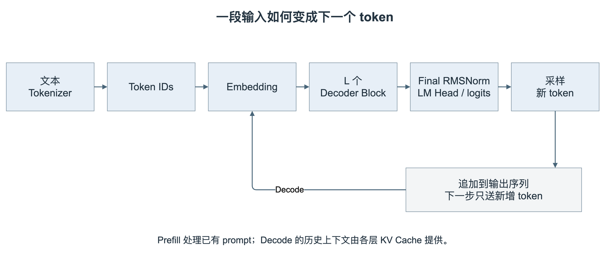
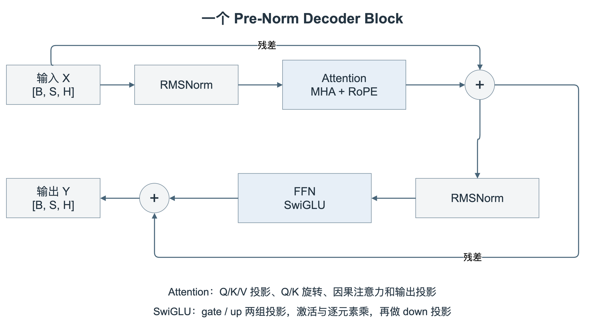
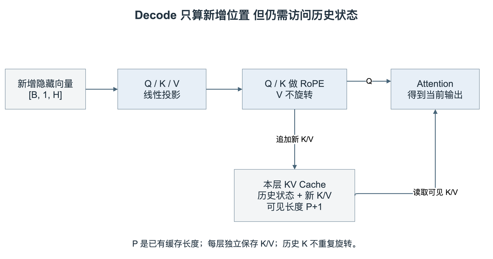
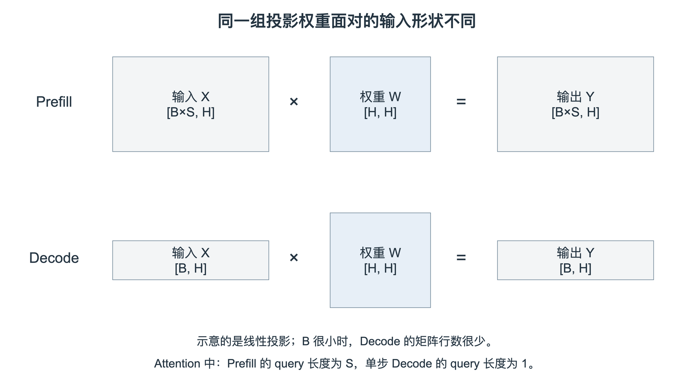
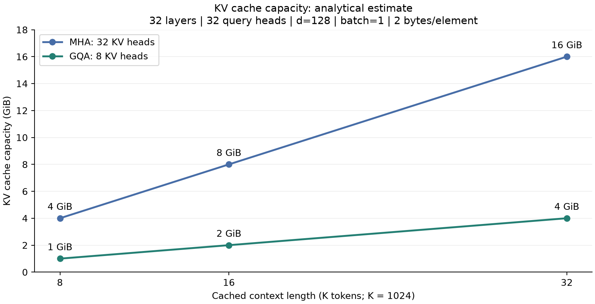

# 从芯片架构看大模型推理

讨论 AI 芯片时，我们很容易先看算力、带宽和片上存储容量。这些指标当然重要，但在决定该配置多少资源之前，还需要弄清楚芯片具体要执行什么工作。

同样是运行一个语言模型，处理一段输入和逐个生成 token，呈现出来的矩阵形状、数据复用和并行机会就很不一样。一个适合大矩阵的计算阵列，面对小 batch 的逐 token 生成时，未必还能保持同样的利用率。把上下文拉长以后，原来够用的缓存和带宽也可能变得紧张。

这也是我最近开始手写小模型的原因。做 NPU 架构和系统仿真，最终还是要把模型映射成芯片能够执行的工作。如果只知道它包含很多矩阵乘法，却不知道这些矩阵有多大、数据要保留多久、下一步何时才能开始，很多架构选择就缺少依据。

我做这部分学习，并不是准备从芯片设计转去研究模型算法，而是想弄清楚自己设计的硬件究竟要服务什么。面向端侧单用户交互，还是云端多请求并发；处理短对话，还是长文档，同一个模型对延迟、吞吐和存储的要求都会不同。所以在讨论阵列规模、片上存储和带宽之前，我想先从模型本身出发，看清一次推理到底做了哪些计算、搬了哪些数据。

这一篇先从一个简化的 Dense Decoder 模型讲起，沿着一次推理，把模型结构和硬件工作负载对应起来。训练方法、对齐和强化学习暂时不展开。文中的 FLOPs 与缓存容量按配置推导；第五节另外给出这份教学实现的 GPU 实测，两种口径分开讨论。

## 一 从输入文本到下一个 token

语言模型接收的不是直接编码成浮点数的文字，而是一串 token ID。Tokenizer 负责把文本映射成词表中的整数编号。一个 token 不一定对应一个汉字，也不一定对应一个完整单词，具体划分取决于 tokenizer。

拿到这些 ID 后，Embedding 从一张可学习的表中取出对应向量。假设 batch 为 B，输入长度为 S，隐藏维度为 H，Embedding 输出的形状就是 `[B, S, H]`。这些向量经过多层 Decoder Block，最后再映射到词表大小 V，得到 `[B, S, V]` 的 logits。

Logits 是词表中各个候选 token 的未归一化分数。生成时通常只取当前最后一个位置的 logits，经过采样或其他选择策略，得到下一个 token，再把它接回序列。这里的“下一个”不是凭空并行产生的：普通自回归生成中，后一个 token 的输入依赖前一个 token 的选择结果。本文不考虑推测解码等改变执行流程的方法。

从硬件角度看，这条路径并不是一种运算。Embedding 主要是按索引读取向量；Decoder 内有大量矩阵乘法，也有归约和逐元素计算；输出投影要把隐藏向量映射到整个词表。即使暂时不讨论芯片实现，光是把这几类工作分开，已经比用一个总 FLOPs 数描述模型更有帮助。

本文使用下面这套教学配置作为算例。它便于拆开观察，不代表某个商业模型，也不是 DeepSeek 的缩小复刻。

| 配置项 | 数值 |
| --- | --- |
| Decoder 层数 L | 6 |
| 隐藏维度 H | 768 |
| Query head 数 | 12 |
| 每个 head 的维度 d | 64 |
| FFN 中间维度 I | 2048 |
| 词表大小 V | 50257 |
| 当前最大序列长度 | 512 |

结构采用 MHA、RoPE、Pre-RMSNorm 和 SwiGLU，输入 Embedding 与输出 LM Head 不共享权重。按当前线性层的 bias 和 RMSNorm 参数一起计算，参数量约为 1.197 亿。后面的解析算例默认 B=1；用 2 字节估算存储时，指的是 FP16/BF16 的元素大小，并未计入完整运行时的临时张量和框架开销。

## 二 拆开一个 Decoder Block

Decoder Block 可以先理解为两个子层：Attention 让当前位置从可见的历史中获取信息，FFN 对每个位置的隐藏向量做进一步变换。本文采用 Pre-Norm，归一化放在各子层之前，输出再通过残差连接加回主干。

### Attention 的输入和输出

输入 X 先经过三个线性投影得到 Q、K、V。这里 Q/K/V 中的 V 表示 Value，与前面用 V 表示的词表大小是不同语境，阅读形状时需要区分。

在普通 MHA 中，合并所有 head 后，三个投影的形状都可以写成 `[B, S, H]`；拆分以后是 `[B, n_h, S, d]`，其中 `H = n_h × d`。以单个 head 为例，Attention 的主要计算为：[1]

$$
\operatorname{Attention}(Q,K,V)=\operatorname{softmax}\left(\frac{QK^{T}}{\sqrt{d}}+M\right)V
$$

Q 与 K 的点积产生匹配分数，因果 mask M 把未来位置排除，Softmax 再将可见位置的分数归一化。这里的“排除”通常是把相应 logits 置为负无穷，而不是在 Softmax 之后简单乘零。归一化后的权重与 Value 相乘，得到每个 head 的输出；多头结果拼接后，再经过输出投影，回到 `[B, S, H]`。

这几步对应的硬件需求不同。Q/K/V 和输出投影是线性层；QK 和后面的权重乘 Value 是矩阵乘法；Softmax 则涉及最大值归约、指数、求和归约和归一化。如果矩阵阵列算完以后，要长时间等待这些向量或归约操作，单看阵列峰值算力就解释不了整个子层的时间。

### RoPE 把位置放进 Q 和 K

模型还需要知道各个 token 所处的位置。本文使用 RoPE，它按位置对 Q/K 的二维通道对做旋转，使注意力点积可以表达相对位置关系；普通 RoPE 的这一步不旋转 Value。[2]

实现时需要把两个约定对齐：哪些通道组成一对，以及对应的角度如何排列。若采用相邻通道配对，那么同一对通道必须使用相同的角度。旋转后的向量应保持长度，这是一个很适合单独验证的数学性质。

这个检查与“带缓存和不带缓存的 logits 是否一致”并不相同。两条推理路径如果用了同一个错误的旋转公式，也可能彼此一致。因此，代码对齐测试之外，还需要独立核对算子的数学定义。

### RMSNorm 和残差连接

RMSNorm 沿隐藏维度计算均方根，再对输入缩放，并乘以可学习的增益。它不需要像 LayerNorm 那样先减去均值。[3]

$$
\operatorname{RMSNorm}(x)_i=\frac{x_i}{\sqrt{\frac{1}{H}\sum_{j=1}^{H}x_j^2+\epsilon}}\,g_i
$$

它的运算量通常没有大矩阵乘法多，但需要沿 H 维归约，并让缩放系数对这一行数据可用。对于 NPU，这会涉及归约路径、数据缓冲和精度安排，而不只是逐元素乘法。

残差连接则把子层输出加回输入。每一层都继续修改同一条隐藏向量主干，并不是把所有层的结果无限拼接起来。这也意味着实现时需要安排好主干数据的生命周期，不能在子层输出回来之前过早覆盖它。

### FFN 不是一个可以略过的小模块

本文采用 SwiGLU。输入走 gate 和 up 两个线性投影，gate 分支经过 SiLU，与 up 分支逐元素相乘，再经过 down 投影：[4]

$$
\operatorname{FFN}(X)=\left[\operatorname{SiLU}(XW_g)\odot(XW_u)\right]W_d
$$

其中 `Wg` 和 `Wu` 的形状为 `[H, I]`，`Wd` 为 `[I, H]`。这是一种数学记法；PyTorch 的 `Linear.weight` 实际保存为 `[out_features, in_features]`，两者不要混淆。

因此，一个 SwiGLU FFN 包含三次线性投影，以及激活和逐元素乘法。对于当前 H=768、I=2048 的配置，FFN 投影矩阵的参数数目是 Attention 四组投影矩阵的两倍。后面的账本也会看到，在长度为 512 的这个算例里，FFN 是很大的一部分矩阵工作量。

## 三 为什么历史 K 和 V 可以缓存

如果每生成一个 token 都把整个前缀重新送进模型，历史 token 的线性投影、FFN 和 Attention 都会反复计算。KV Cache 用来避免其中不必要的历史重算。

它成立的前提是因果性。在模型参数和输入前缀不变、推理行为确定的条件下，历史位置的隐藏状态不能依赖后面新加入的 token。因此，各层历史位置产生的 K/V 也不需要重新计算。新的 query 可以直接读取这些缓存。

注意缓存是逐层保存的。第 1 层和第 6 层看到的隐藏状态不同，得到的 K/V 也不同，不能全模型共用一份。使用 RoPE 时，历史 K 已经按各自位置旋转过，拼接新 K 时不能再把旧 K 重新旋转一遍。

假设缓存里已经有 P 个位置，现在输入一个新 token。那么新 token 的位置是 P，需要计算新的 Q/K/V，并把新的 K/V 写到相应位置。Attention 的 query 长度是 1，key/value 长度则是 `P+1`。它仍然要从可见历史中获取信息，**缓存并没有让当前 query 对历史的 Attention 计算消失**。

这也解释了一个常见误区：KV Cache 主要省下历史位置的重复前向，不是把每个新 token 的全部计算都变成常数。对完整历史做 Attention 时，读取的缓存和 QK/PV 工作量仍然随上下文长度增长。

教学代码里可以通过 `torch.cat` 把新 K/V 拼到缓存后面，逻辑比较直观。但它通常要分配新张量并复制历史内容，不等于硬件上“只追加一小段”。分析存储流量时，应把这个软件实现的复制开销与模型本身需要的缓存访问分开。生产实现还可能使用预分配、分页或其他缓存管理方式。

## 四 Prefill 和 Decode 是两种不同的工作负载

一次普通的生成通常先处理 prompt，这一阶段称为 Prefill。虽然模型有因果约束，prompt 的多个位置仍然可以通过带 mask 的矩阵运算一起计算，因为它们的输入 token 已经全部给出。

Prefill 建立各层的 KV Cache，并通过最后一个输入位置的 logits 选择第一个输出 token。之后的 Decode 则把新生成的 token 继续送入模型，每次只计算新增位置，再使用更新后的历史状态预测后一个 token。

因此，如果没有其他提前终止条件，生成 N 个新 token 通常需要一次 Prefill 和 N−1 次后续 Decode 前向。最后一个输出 token 已经选出来以后，如果不需要它的后续 logits 或更新后的缓存，就没有必要再为它多做一次前向。

以线性投影为例，Prefill 中的 X 可以把 batch 和序列维合并成 `[B×S, H]`；Decode 中，每个请求只有一个新增位置，合并后是 `[B, H]`。当 B 很小时，后者离一个大规模矩阵乘法相差很远。

对一组投影权重，若能在一批输入之间充分复用，并忽略其他流量，理想的权重复用算术强度可以粗略写成：

$$
\mathrm{AI}_{\mathrm{weight}}\approx\frac{2B}{b}\quad\text{FLOP/byte}
$$

这里 b 是每个权重的存储字节数。B=1、b=2 时，只有约 1 FLOP/byte；Prefill 中可用的行数还包含 S，理想复用机会会更多。这个估算没有计入 KV、激活、量化元数据，也不代表实际片上复用已经实现。

这就是为什么小 batch Decode 往往对带宽敏感。但不能反过来认定所有 Decode 都受带宽限制，也不能认定所有 Prefill 都受算力限制。Batch、上下文长度、权重是否留在片上、算子融合和内存布局都会改变结果；长上下文 Prefill 中，Attention 的计算和数据访问也会显著增长。

对服务系统而言，还需要区分指标：用户等待第一个 token 的时间通常称为 TTFT，除了 Prefill，还可能包含排队、分词和调度；后续 token 的间隔反映交互流畅度；吞吐率则要同时注明并发量。单独报告一个 tokens/s 数字，往往不足以说明体验和硬件利用情况。

## 五 给这套小模型算一笔账

为了让讨论有具体尺度，下面按 B=1、S=512、H=768、I=2048 计算单个 Decoder Block 的主要矩阵 FLOPs。Decode 一列的 query 长度为 1，可见 K/V 长度为 512。

本文把一次乘法和一次加法计为 2 FLOPs，所以 `[M,K] × [K,N]` 的矩阵乘法按约 `2MKN` 计算。这里只统计主要矩阵乘法，不包含 bias、RMSNorm、RoPE、Softmax、SiLU、逐元素乘法、残差和采样。

| 单个 Block 的主要矩阵运算 | Prefill FLOPs | 单步 Decode FLOPs |
| --- | --- | --- |
| Q/K/V 三组投影 | 1.812 GFLOPs | 3.539 MFLOPs |
| Attention 的 QK 与 PV | 0.805 GFLOPs | 1.573 MFLOPs |
| Attention 输出投影 | 0.604 GFLOPs | 1.180 MFLOPs |
| SwiGLU 三组投影 | 4.832 GFLOPs | 9.437 MFLOPs |
| 合计 | 8.053 GFLOPs | 15.729 MFLOPs |

Attention 的估算按显式 dense 乘法计数，包括之后被因果 mask 屏蔽的位置。若 kernel 能跳过因果上三角的计算，实际执行的 FLOPs 会不同，不能把这张表当成任意优化实现的指令计数。

6 个 Block 的 Prefill 主要矩阵计算合计约为 48.32 GFLOPs，尚未包含最终 LM Head。这个结果里，FFN 投影的计算量比 QK 和 PV 加起来还大，说明不能因为 Attention 更受关注，就把其他部分从芯片负载里略去。

输出投影也值得单独看。当前 H=768、词表大小 50257，只为最后一个位置计算 logits，约需要 77.19 MFLOPs；如果像教学版 `forward()` 那样，为全部 512 个位置都计算 logits，就约为 39.52 GFLOPs。训练通常需要各位置的输出，普通生成的 Prefill 则可能只需要最后一个位置。两种执行路径的账并不相同。

单步 Decode 中，6 个 Block 加上一个位置的 LM Head，主要矩阵运算约为 171.57 MFLOPs。对这套词表相对较大的小模型，LM Head 也不是一个可以忽略的尾部步骤。

再看存储。按普通 MHA、2 字节元素估算，512 个位置的各层 KV Cache 合计为 9 MiB；为一个新 token 追加各层 K/V，仅需 18 KiB。两者分别是“已经保存的状态”和“本次新写入的状态”，不能混为一谈。

对于权重，同样要区分容量和访问量。输入 Embedding 通常按 ID 读取行，而不是每生成一个 token 都读完整张表。如果假设 Decoder 和 LM Head 的投影权重都无法长期留在片上、每批 Decode 从外存各读取一遍，这部分权重约为 154.62 MiB。它是特定复用假设下的量级估算，不是带宽测量结果，更不能直接用整模型参数字节数代替每步访存量。

上述数值均可由仓库里的[估算脚本](../tools/estimate_workload.py)重新生成，详细假设保存在[估算数据](../data/llm-inference/estimates.json)中。配置、统计范围和单位写清楚以后，数字才适合被拿来讨论架构。

### 放到 GPU 上跑一遍

算完以后，我在一张 RTX 4090 D 24GB 上跑了同一配置。环境是 PyTorch 2.7.0、CUDA Runtime 12.8，关闭 TF32。先检查 RoPE 的独立旋转性质、因果性和缓存路径，再做性能测试。原 Notebook 中相邻通道配对与频率排列不一致，测试时在内存中将频率的 `repeat` 改为 `repeat_interleave`，没有覆盖原文件。

下面是预热 3 次、重复 20 次后，带 CUDA 同步的墙钟时间中位数。Prefill 输入长度为 512；Decode 输入一个新位置，包含它在内的可见 KV 长度为 512，历史缓存的建立不计入这一步。推理时将模型权重直接转为对应精度，关闭 dropout，不使用自动混合精度。

| 精度与 batch | Prefill 时间 | 单步 Decode 时间 |
| --- | --- | --- |
| FP32 B=1 | 40.65 ms | 34.42 ms |
| BF16 B=1 | 42.51 ms | 34.14 ms |
| FP16 B=1 | 41.19 ms | 34.37 ms |
| FP32 B=12 | 53.58 ms | 35.70 ms |
| BF16 B=12 | 45.37 ms | 39.79 ms |
| FP16 B=12 | 45.85 ms | 36.97 ms |

这里最值得注意的，恰恰是它与纯 FLOPs 比例相差很大。教学代码逐个 head 执行 Attention，显式计算分数，用 `torch.cat` 扩展缓存，而且 Prefill 会计算所有位置的词表 logits；没有使用 SDPA、FlashAttention、`torch.compile` 或 CUDA Graph。算子形状改变以后，计算量下降了很多，单步时间却没有等比例下降。小算子调度、CPU 发起开销以及内存分配都值得进一步用 profiler 排查；仅凭这张表，还不能给它们分配准确的耗时占比。

因此，这组结果是**当前教学执行路径的基线，不是 RTX 4090 D 跑这个模型的性能上限**，也不能用它判断 BF16 通常是否比 FP32 快。20 次测试仍有波动，原始数据保留了 P10/P90。后面如果把多头合并、减少中间张量或更换 kernel，需要在同一数学定义下重新比较。

正确性方面，完整模型在 FP32 下，最后一个位置的缓存与完整前向 logits 最大绝对误差约为 `2.50e-6`；BF16 和 FP16 分别约为 `0.0239` 和 `0.00366`，不能要求逐 bit 相同。这只是随机权重和测试输入下的数值检查，不是对低精度生成质量的保证。另以 B=12、S=512，分别执行 FP32 和 BF16/FP16 AMP 的 3 步 AdamW 训练，loss 与梯度均为有限值；它验证了前向、反向与更新链路，不代表训练已经收敛。

本次推理基准直接调用 `forward()`，未经过原有 `generate()`。后者还存在不必要的额外前向、到达上下文边界即停止以及过长 prompt 截断等行为，需要单独整理，不能把本次测试说成完整生成接口已经验证无误。详细配置、显存数据和复现方式见[CUDA 测试记录](../experiments/cuda-20261025.md)。

## 六 上下文和并发会把存储需求推到哪里

对于普通 MHA/GQA，未考虑分页元数据、padding 和量化附加信息时，缓存容量可以写成：

$$
C_{\mathrm{KV}}=2LBTn_{\mathrm{KV}}db
$$

前面的 2 对应 K 和 V；L 是层数，B 是同时保存的序列数，T 是每条序列保存的长度，`nKV` 是 KV head 数，d 是每个 head 的维度，b 是每个元素的字节数。若各请求长度不同，则应把 `B×T` 替换为各请求缓存长度的总和。

MHA 中 KV head 数与 Query head 数相同。GQA 让一组 Query head 共享 K/V，因此减少缓存的 head 维；MQA 可以看作只保留一组 K/V 的情况。[5] 注意，这不意味着相应比例地减少所有 Query head 的 Attention 计算。

为了看清容量随上下文变化的尺度，再取一个**独立的假设配置**：32 层、32 个 Query head、head dim 为 128、B=1、每元素 2 字节。它不是前面最大长度 512 的教学模型，也不表示当前代码已经支持下面的长度。

| 保存的上下文长度 | MHA 的 KV Cache | 8 个 KV head 的 GQA |
| --- | --- | --- |
| 8192 | 4 GiB | 1 GiB |
| 16384 | 8 GiB | 2 GiB |
| 32768 | 16 GiB | 4 GiB |

这还只是一个请求的缓存。并发增加以后，容量继续增长，Decode 对历史状态的访问也随之变化。因此，长上下文和高并发不是给同一个模型简单换两个启动参数，它们会改变存储和调度需要面对的问题。

也需要把两类内存分开：KV Cache 是随序列保留的状态；显式实现中的 Attention score 则可能是 `[B, n_h, S, S]` 的临时张量，两者的生命周期和增长规律不同。

FlashAttention 通过分块和在线 Softmax 等方式减少 HBM 与片上 SRAM 之间的中间数据往返，不需要把完整 score/probability 矩阵都写回外存。它仍然是在计算精确的 dense Attention，而不是因为没有落地整个矩阵，就变成了稀疏 Attention；这里的“精确”也不要求不同浮点实现逐 bit 相同。[6]

所以，看到某段 PyTorch 代码分配了一个大张量，应该进一步问：这是模型必须保留的状态，还是当前执行方式产生的中间结果？芯片有时需要提供容量，有时则应通过融合和数据流设计，让这块外存分配根本不发生。

## 七 把这些计算放回 NPU 架构里

到这里，再看矩阵阵列、向量单元、SMEM 和 DMA，它们的分工就更具体了。

矩阵阵列需要面对的不只是一个“支持 GEMM”的要求。Prefill 和小 batch Decode 的行数差异很大，阵列切分、数据广播和调度方式都会影响利用率。权重与激活进入片上的顺序、tile 大小和可复用次数，也要与实际矩阵形状匹配。

向量和归约路径要承担 RMSNorm、Softmax、激活和逐元素运算。这些部分未必占很多 FLOPs，却经常处于前后矩阵运算之间。流水是否能持续推进，取决于它们的吞吐、归约延迟、缓冲组织和精度要求，而不是只看单个函数是否“支持”。

KV Cache 则带来另一类状态访问。历史数据需要读到 Attention 计算侧，新位置的数据要写入对应缓存，长期容量、分页映射和片上暂存是不同层次的问题。即使权重做了低比特量化，KV 状态和其他数据流量也不会自动按相同比例缩小；量化的 scale、反量化和累加精度还需要单独安排。

从整体上看，可以先用一个很粗的下界检查数量级：

$$
t\geq\max\left(\frac{F}{P},\frac{D}{\mathrm{BW}}\right)
$$

F 是工作量，P 是对应精度和运算类型下的计算吞吐上限，D 是在已声明复用假设下必须搬运的数据量，BW 是对应存储层级的带宽上限。两项必须使用一致的范围和单位。

这不是延迟预测公式。算子之间有依赖，通信未必能与计算完全重叠，实际吞吐也通常达不到峰值。尤其不能把峰值 TOPS、不匹配的数值精度和随意估出来的外存流量拼在一起，就当作一个可信的模型执行时间。它更适合先检查“目标是否明显不可能”，再通过执行图和时序模型继续细化。

具体落到仿真，我会先固定模型版本、batch、prompt 长度、生成长度和精度，然后记录算子的 shape、执行顺序及数据生命周期，再逐步映射到 Engine 和存储通路。服务场景也要保留：单请求低延迟与批量高吞吐，可能需要不同的调度取舍。

## 八 再往 Hybrid Attention 走

有了这套基线，再看其他 Attention 结构，就可以追问它们具体改变了哪一笔账。

GQA 减少保存的 KV head 数；MLA 用潜在表示压缩历史状态，投影和矩阵吸收的安排也会影响 Decode 的计算路径。[7] 滑动窗口、压缩和稀疏选择则可能改变可访问历史的范围、保存方式或检索过程。它们不能统一套用普通 MHA 的完整缓存公式。

下一步我准备继续研究 DeepSeek-V4 的 Hybrid Attention，相关结构以官方实现和配置为准。[8] 对芯片而言，除了省下多少 Attention 计算，还要看增加了哪些压缩、索引、选择和数据搬运，以及这些工作是否容易并行、是否产生不规则访问。本文尚未完成这部分复现，也没有它的性能数据。

例如，在 PyTorch 中先计算全部分数，再把未选中的位置 mask 掉，可以帮助核对语义，但不代表硬件已经跳过了这些位置的运算。模型层面的稀疏、kernel 实际执行的工作和芯片最终节省的时间，需要分开验证。

我希望先把一个普通 Decoder 的执行过程看明白，再沿着具体结构的变化继续分析。这样回到芯片设计时，讨论的不只是“增加多少算力”，而是这部分资源能否服务于我们真正要运行的模型和场景。

## 参考资料与代码来源

手写模型的学习起点是 chaofa 的 [LLMs-Zero-to-Hero](https://github.com/bbruceyuan/LLMs-Zero-to-Hero)，原项目采用 Apache-2.0 许可证。本文的教学配置在该学习基础上引入了 RMSNorm、SwiGLU、RoPE 和 KV Cache；不应把这些本地改造与原仓库的原样实现混为一谈。本文配图重新绘制，FLOPs 与容量由配套脚本计算，没有复制原项目的整套 Notebook 或训练资产。

1. Vaswani et al. [Attention Is All You Need](https://arxiv.org/abs/1706.03762)，2017。
2. Su et al. [RoFormer: Enhanced Transformer with Rotary Position Embedding](https://arxiv.org/abs/2104.09864)，2021。
3. Zhang and Sennrich. [Root Mean Square Layer Normalization](https://arxiv.org/abs/1910.07467)，2019。
4. Shazeer. [GLU Variants Improve Transformer](https://arxiv.org/abs/2002.05202)，2020。
5. Ainslie et al. [GQA: Training Generalized Multi-Query Transformer Models from Multi-Head Checkpoints](https://arxiv.org/abs/2305.13245)，2023。
6. Dao et al. [FlashAttention: Fast and Memory-Efficient Exact Attention with IO-Awareness](https://arxiv.org/abs/2205.14135)，2022。
7. DeepSeek-AI et al. [DeepSeek-V2: A Strong, Economical, and Efficient Mixture-of-Experts Language Model](https://arxiv.org/abs/2405.04434)，2024。
8. Hugging Face Transformers. [DeepSeek-V4 模型文档](https://huggingface.co/docs/transformers/main/en/model_doc/deepseek_v4)。该链接指向持续更新的主线文档，后续复现时需要固定具体版本。

作者：Ch'in。本文公式、配置与参考链接核对日期：2026 年 10 月 25 日。解析估算与 RTX 4090 D 上的教学实现实测分别注明口径，未提供 DeepSeek-V4 或 NPU 的性能实测。
