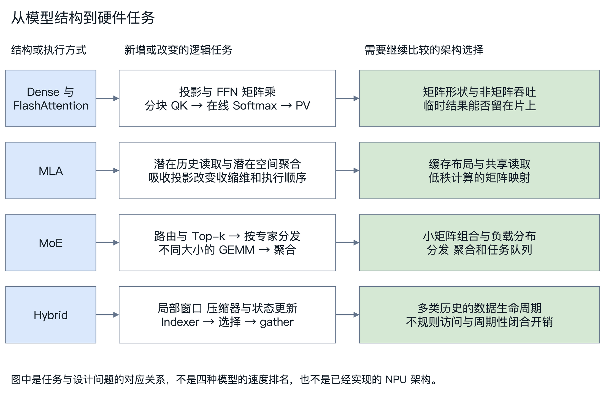
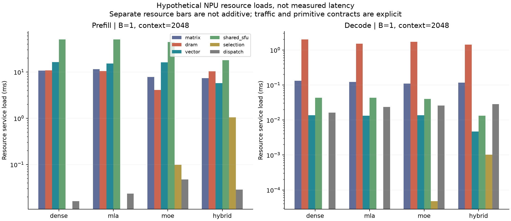
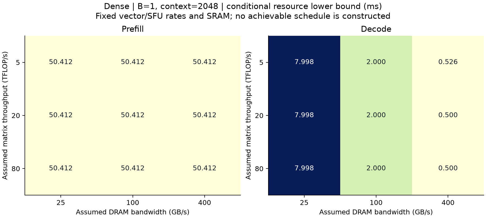
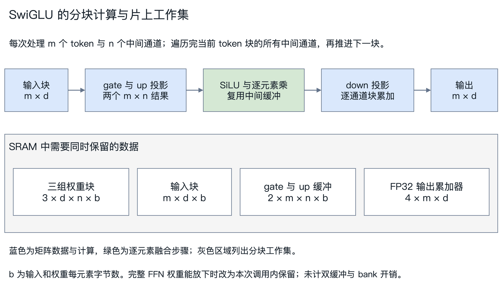
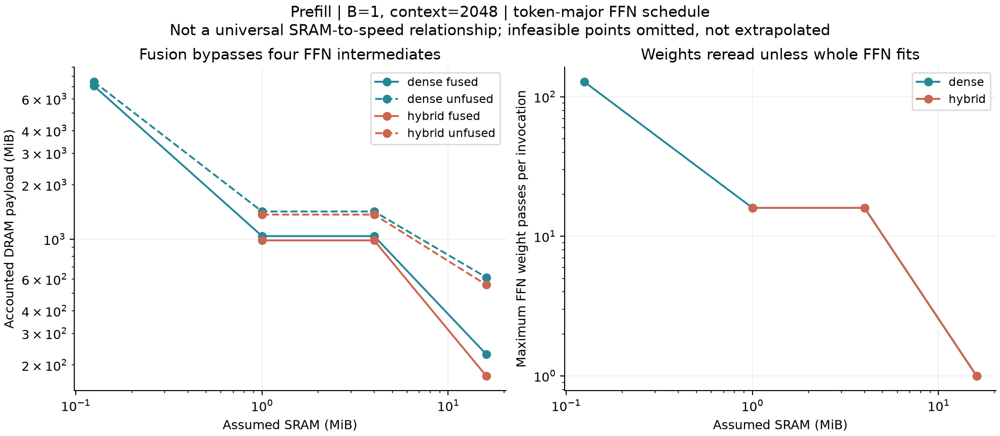
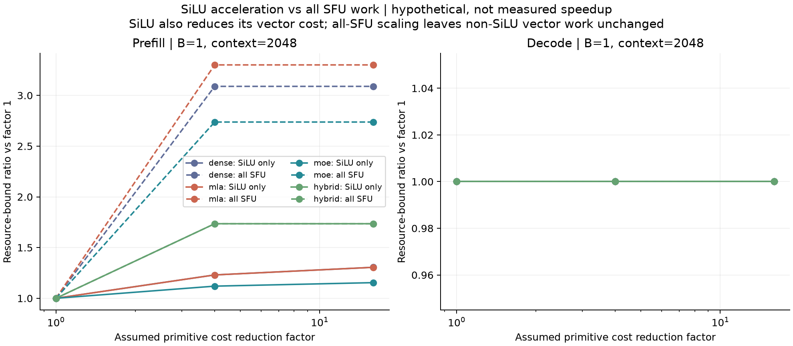

# 从大模型到 AI 芯片 四 从推理工作负载到 NPU 架构

第二篇里，MLA 把小模型的缓存缩小了 9.6 倍，但普通 PyTorch 实现没有更快；MoE 每个 token 激活的专家权重更少，Decode 却花了更多时间。

前者减少了历史状态，后者减少了每个 token 的专家计算，但执行时还有投影、分发、聚合和数据搬运。省下其中一项，不能直接换算成整模型的加速比。回到 NPU，这些任务该怎么分配给计算单元，数据应该留在哪里？

这一篇沿用前三篇的四种小模型，统计它们的任务形状和数据流量，再改变算力、带宽、SRAM 与非矩阵吞吐，观察资源需求怎么变化。讨论的起点仍然是应用场景：单用户交互、长文处理和批量离线生成，对同一颗芯片的要求并不相同。

为此，我写了一份可以修改参数的工作负载分析器。**本篇新增的时间和流量数据都来自解析模型，不是 GPU 或 NPU 实测。** 它用于比较资源需求，暂时没有接入事件级仿真，不能直接预测芯片的 token/s。

## 一 应用场景

芯片要跑什么模型，还不足以确定负载。输入多长、同时服务多少请求、允许等多久，也要一起定下来。

交互式对话既要看首 token 延迟，也要看后续 token 的 Decode 延迟。批量离线生成可以接受更长的等待，优先提高总吞吐。输入换成长文，Prefill、历史状态和 Attention 在整步执行中的占比又会变化。

线性层可以先用来说明这种差别。输入为 M×K，权重为 K×N，主要计算量为：

$$
F=2MKN
$$

一次乘加记作 2 FLOPs。若一批 token 共同使用一份权重，权重只从外存读取一次，只计权重流量时，算术强度为：

$$
I_W=\frac{2MKN}{bKN}=\frac{2M}{b}
$$

b 是每个权重元素的字节数。M 越大，一次权重读取对应的计算就越多。这里没有计输入、输出和其他流量，也没有权重重读，只用于说明权重复用，不是整模型的算术强度。

Prefill 一次处理多个输入位置，线性层通常有较大的 M；单请求 Decode 每次只处理一个新位置，M 可能只有 1。权重相同，适合的执行方式却不一样。

增加 batch，可以把不同请求的新 token 合起来，改善矩阵形状和权重复用。但各请求的 KV 历史通常不同，历史读取不会按同样比例摊薄，服务侧还要付出等待组批的时间。单请求延迟和总吞吐需要分别看。

本文只分析推理。前三篇的短程训练用于检查模型的学习过程，这次不计反向传播、梯度和优化器状态。

## 二 模型配置与矩阵形状

分析器直接复用前三篇的配置：主干 6 层、隐藏维 768、12 个注意力头，Dense SwiGLU 中间维为 2048。

| 变体 | 参数量 | 本次使用的结构 |
| --- | ---: | --- |
| Dense | 119,690,496 | MHA 与 Dense SwiGLU |
| MLA | 111,858,432 | absorbed MLA 与 Dense SwiGLU |
| MoE | 148,038,912 | MHA 与 8 专家 Top-2 SwiGLU |
| Hybrid | 109,310,216 | 第三篇的 SWA CSA HCA 混合层与 Dense SwiGLU |

这四个模型用于观察执行机制，训练质量没有对齐。后面的比较针对各自的工作量，不作模型性能排名，也不按参数量外推生产模型。

以 gate/up 投影为例。固定 batch=1，Prefill 输入长 2048，Decode 只输入一个新 token。M、K、N 分别表示矩阵乘的行数、收缩维和输出列数。

| 任务 | M | K | N |
| --- | ---: | ---: | ---: |
| Dense Prefill 的 gate 或 up | 2048 | 768 | 2048 |
| Dense Decode 的 gate 或 up | 1 | 768 | 2048 |
| MoE Decode 的一个选中专家的 gate 或 up | 1 | 768 | 512 |

后两行的 M 只有 1。如果一种映射把 M 按 16 补齐，又没有其他任务填补空位，这一维的有效槽位就只占 1/16，也就是 6.25%。这是该映射下的结果，换一种数据映射、拆分阵列，或组合多个请求与专家任务，利用率也会变化。

所以选矩阵单元之前，要先列出 M/N/K 的分布。大 GEMM 和小 GEMM 各有多少，尾块浪费在哪里，MoE 每个专家分到多少 token，都比一个总 FLOPs 数更接近阵列实际要处理的任务。



矩阵乘之外，MLA 改变了缓存布局和计算的收缩维，MoE 增加路由、分组和聚合，Hybrid 又多了压缩器、Indexer、选择和 gather。这些任务也要分配计算与存储资源。几种结构可以组合，不是互相替代的关系。

## 三 资源预算

这轮分析在 Mac 的 CPU 上运行，核心只用 Python 标准库。分析器把模型拆成有前驱依赖的逻辑任务，分别记录矩阵形状、逐元素计算、归约、特殊函数、候选选择、状态和数据搬运。

batch 取 1、4、16，长度取 512、2048、8192，分别计算 Prefill 和 Decode，共 72 条基线。Prefill 从空历史开始；Decode 的长度包含当前 token。LM Head 只处理最后一个位置，不计采样。

Attention 的计数与第一篇有一处区别：第一篇按完整掩码矩阵计算，这次只计因果有效项。长度为 T 时，每个 head 的 Prefill 配对数为 T(T+1)/2，对应能够跳过无效项的执行。显式线性层还会按阵列 tile 补齐，Attention 和 Indexer 暂未计入 tile 浪费；这些数不等于前几篇 PyTorch 路径实际发出的全部运算。

硬件使用下面这组假设参数，不对应某个产品，也没有用 RTX 4090 的耗时拟合。

| 资源 | 示例配置 |
| --- | --- |
| 矩阵吞吐 | 低精度 20 TFLOP/s FP32 5 TFLOP/s 共用阵列 |
| DRAM 带宽 | 100 GB/s 按十进制字节计 |
| SRAM 容量 | 4 MiB |
| 向量算术吞吐 | 每秒 64G 次预算操作 |
| exp 倒数 rsqrt 吞吐 | 每秒分别 4G 4G 1G 个元素 共用 SFU 预算 |
| 候选选择吞吐 | 每秒扫描 1G 个候选项 |
| 逻辑命令发起成本 | 每条 0.2 us |
| 线性层计算 tile | 16×16×16 |

SFU 是特殊函数单元，这里统计 exp、倒数和倒数平方根的需求。候选选择按扫描项数估算，没有展开某个 Top-k 算法的比较过程。表中的命令对应分析器里的逻辑任务，不是 CUDA kernel 或真实 NPU 指令。

一类资源的总需求量除以它的吞吐，就是所需的服务时间。矩阵和访存两项分别为：

$$
t_{\mathrm{matrix}}=\frac{F_{\mathrm{issued}}}{P},\qquad t_{\mathrm{DRAM}}=\frac{D}{BW}
$$

F_issued 是补齐后的矩阵工作量，P 是对应精度的吞吐，D 是当前数据流下的外存字节数。不同精度共用阵列，就把各自的占用时间加到同一资源上；共用 SFU 的几种函数也这样处理。

沿用 [Roofline](https://www2.eecs.berkeley.edu/Pubs/TechRpts/2008/EECS-2008-134.html) 将计算与数据移动放在一起分析的思路，我另外计入向量、SFU、选择和命令发起，取各资源服务时间的最大值：

$$
t_{\mathrm{resource}}=\max\left(t_{\mathrm{matrix}},t_{\mathrm{DRAM}},t_{\mathrm{vector}},t_{\mathrm{SFU}},t_{\mathrm{select}},t_{\mathrm{dispatch}}\right)
$$

不同资源可以重叠工作，所以这些时间不能直接相加。取最大值，得到的是**当前流量和吞吐假设下的条件资源下界**。资源总量满足要求，不代表任务能按依赖连续执行，实际延迟还要由调度决定。

分析器保存了逻辑依赖，但没有事件调度器。bank 冲突、DMA 启动、总线争用和逐 tile 流水还没有建模，因此这里只比较资源预算，不把下界当成可达到的延迟。

## 四 算力与带宽

下面取 Dense、batch=1、长度 2048。Prefill 处理整段输入，Decode 只推进一个新 token，表中是各资源的服务时间，单位 ms。

| 资源服务时间 | Prefill ms | Decode ms |
| --- | ---: | ---: |
| 矩阵 | 10.693 | 0.132 |
| DRAM | 10.902 | 2.000 |
| 向量算术 | 16.320 | 0.014 |
| 共享 SFU | 50.412 | 0.043 |
| 候选选择 | 0 | 0 |
| 逻辑命令发起 | 0.016 | 0.016 |

这组配置下，Prefill 的最大项是 SFU，Decode 则是 DRAM。按当前吞吐配比，Prefill 需要先检查非矩阵资源，Decode 需要先看数据搬运。



我又把矩阵算力从 5 扫到 80 TFLOP/s，带宽从 25 扫到 400 GB/s。Dense Prefill 的条件资源下界几乎不变，仍然由固定不动的 SFU 决定。



为什么增加算力和带宽，Prefill 这一列没有变化？因为取最大值时，SFU 仍然高于另外几项。只增加其他资源，改变不了这个结果。换一组 SFU 吞吐、序列长度或数据流，最大项也会随之变化，不能据此说 Prefill 不需要矩阵算力和带宽。

这类扫描用于筛选后续要比较的资源。面积和功耗怎么分配，还要看各单元的实现成本，这轮没有求最优配比。

## 五 容量与流量

MLA 的缓存已经变小，为什么整步访存没有按同样比例下降？

容量是保留当前状态所需的空间，流量是执行这次调用时跨某一级存储搬运的数据量。一份状态可能反复读取，也可能一直留在片上。压缩历史以后，还可能需要额外的投影或选择才能取到当前数据。

batch=1、长度 2048 时，MHA 的逻辑历史状态为 36 MiB，MLA 为 3.75 MiB，相差 9.6 倍。但这次 Decode 的整步 DRAM 载荷分别约为 190.692 和 143.503 MiB。整步还要读取权重和其他数据；本次假设投影权重不跨调用常驻，压缩 KV 省不掉这部分读取。

若部分权重能跨步常驻，这两组流量就会改变。batch、缓存布局、query 分块和复用方式也要一起考虑。

Hybrid 则要分开统计局部窗口、主压缩历史、Indexer 历史、未完成块和重叠状态。它们的生命周期不同。top-k 限制的是当前主 Attention 使用多少压缩块，其他历史仍要保留，因为下一次 query 可能选择另一组。

本文按一种有利于 Attention 复用的数据流估算：完整 score/probability 矩阵不写回外存，不计 query 分块导致的重复 KV 读取，以及残差和非 FFN 中间张量的 spill。MLA 的潜在状态在 QK/PV 之间复用；Hybrid 选中向量即使刚刚生成，也按从 DRAM 读取计入。这是一组明确的数据流假设，不是已证明的最小访存量。

做存储规划时，需要分别列出权重、历史、临时激活和控制元数据，注明生产者、消费者、保留时间和访问频率。模型占多少 GB 回答的是容量问题，SRAM 分给谁还要看这些数据能省下多少搬运。

## 六 SRAM 与算子融合

SRAM 容量会影响分块方式和权重重读次数。以 SwiGLU 为例：

$$
G=XW_g,\qquad U=XW_u,\qquad Y=\left(\operatorname{SiLU}(G)\odot U\right)W_d
$$

gate、up、SiLU 和逐元素乘法如果各自执行、各自写回外存，中间结果就要多次往返。融合让这些结果在片上直接交给后续计算，减少写回和重读。[FlashAttention](https://arxiv.org/abs/2205.14135) 也通过分块减少 score/probability 的外存访问，不过依赖和分块方法不同。

这些数据能否同时留在片上？我用了一个简化的 token-major 方案：每次处理 m 个 token、n 个 FFN 中间通道，保留三组权重块、输入、gate/up 缓冲和 FP32 输出累加器。

$$
S_{\mathrm{tile}}=3dnb+mdb+2mnb+4md
$$

d 是模型隐藏维，b 是输入和权重每元素的字节数，最后一项是 4 字节的 FP32 累加器。SiLU 和逐元素乘法复用中间缓冲。这里按独占 SRAM 计算，未计双缓冲、bank padding 和 ECC。



Dense 单层的完整 FFN 权重按两字节计算是 9 MiB。如果完整权重和激活都放得下，就在本次 FFN 调用里保留权重；否则，每处理下一个 token 块都要重读。分块器优先减少重读遍数，再选择较大的 m、n，没有搜索全局最短调度。

固定 batch=1、长度 2048，下面统计**整个 Prefill 调用**的 DRAM 载荷。unfused 对照使用相同的权重读取计划，只额外计入四份中间张量各写回和读入一次。

| SRAM MiB | FFN 权重最多读取遍数 | fused 流量 MiB | unfused 流量 MiB |
| --- | ---: | ---: | ---: |
| 0.125 | 128 | 7087.673 | 7471.673 |
| 1 | 16 | 1039.673 | 1423.673 |
| 4 | 16 | 1039.673 | 1423.673 |
| 16 | 1 | 229.673 | 613.673 |

融合省下的是四份中间张量的往返；SRAM 足够大时，还能保留完整 FFN 权重，减少权重重读。这是两种不同的收益。

为什么 1 MiB 和 4 MiB 的结果相同？当前 token tile 上限是 128，这两种容量下选出的权重读取遍数相同。换一个循环顺序、分块上限，或允许部分累加结果写回，就会形成另一组容量与流量的权衡。



Hybrid 会先为所有层的待完成压缩块和重叠状态预留空间，再检查一个独占 FFN 块能否放下。这个检查还没有覆盖全图活跃区间，Attention、残差和层间数据的存储安排需要另算。

选 SRAM 时，除了容量，还要看 bank、端口、访问带宽和数据生命周期。进一步模拟 DMA 与计算重叠时，也要把双缓冲占用的空间算进去。

## 七 激活与归约

矩阵和存储之外，再看 SiLU、Softmax 和归一化对非矩阵资源的需求。

SiLU 可以写成：

$$
\operatorname{SiLU}(x)=\frac{x}{1+e^{-x}}
$$

本文把 SiLU 分解成 exp、倒数和逐元素算术来估算成本。硬件也可以用查表或分段逼近，不必依次执行这些基本操作。

Dense、batch=1、长度 2048 时，一次 Prefill 共处理 25,165,824 个 SiLU 元素。要判断是否做专用单元，还得看它和哪些函数共用资源，以及前后两级能否持续供数和接收结果。

我分别改了两组成本：一组只降低 SiLU 相关基本操作的成本，另一组提高所有 SFU 基本操作的吞吐。后一组还会影响 Softmax 和归一化。

| 成本假设 | Dense Prefill 条件资源下界 ms | Dense Decode 条件资源下界 ms |
| --- | ---: | ---: |
| 默认配置 | 50.412 | 2.000 |
| SiLU 相关成本降至 1/16 | 38.615 | 2.000 |
| 所有 SFU 基本操作成本降至 1/4 | 16.320 | 2.000 |

单独降低 SiLU 成本，Prefill 的资源下界从 50.412 降到 38.615 ms，Softmax 等其他需求仍然存在。所有 SFU 成本降低后，下界降到 16.320 ms，最大项转为向量算术。默认 Decode 由 DRAM 需求决定，两种改动都没有改变它的资源下界。



这里改的是成本参数，没有设计一个 16 倍速的 SiLU 单元，也没有计入面积、功耗、端口和新增数据转换。表中给出的是资源下界的变化，不是整模型的实测加速比。

单元延迟和吞吐还要分开。一个单元十几个周期后才给出结果，仍可能在流水充满后每周期接收一组独立输入。要维持这个吞吐，上游供数和下游接收都得跟上。

Softmax 还多了归约。做在线 Attention 时，需要维护最大值、归一化因子和部分输出等反馈状态。exp 能全流水，同一行的状态递推却未必能每周期启动。交错多行、分块统计后合并或改写递推形式，都要检查依赖、缓冲和精度。算法依据见[在线 Softmax 原文](https://arxiv.org/abs/1805.02867)，具体流水组织尚未在本轮验证。

精度检查也要连到模型里。第二、三篇已经出现过低精度扰动改变专家或历史块选择的情况。激活近似或量化误差传到 router、Indexer 后，可能改变后续执行路径，单个函数的最大误差不足以判断整模型是否对齐。原有 BF16 未通过项仍然保留。

因此，专用单元的选择要同时看共享向量、归约和 SFU 的需求。LUT 或分段多项式的误差、输入范围与异常值处理，再结合模型容差和综合结果评估，不能只按函数调用次数定方案。

## 八 任务调度

MoE 的专家矩阵大小随路由结果变化，Hybrid 的评分、选择和 gather 又有不同的访问方式，压缩块闭合时还要更新状态。这些任务不适合只用一个平均矩阵尺寸描述。

MoE 的映射需要连同按专家分组、grouped GEMM 和聚合路径一起安排。本次分析只设置可复现的均衡与集中路由场景，没有使用训练后 router 的实际分布，也没有模拟多核或跨卡专家通信。

第三篇的连续 Decode 中，压缩块闭合位置和普通位置的工作不同。只测恰好闭合的 token，会把周期性更新当成每步固定成本。交互应用还要看这些更新是否形成延迟尖峰，平均服务量回答不了这个问题。

控制侧还有几个问题：任务由 CPU 逐个发起，还是交给设备队列连续推进？一个专家的输入何时收齐，能否提前执行？DMA 完成后怎样唤醒消费者？合并小任务会不会延迟其他请求？

0.2 us 的假设命令成本没有展开这些过程。批量提交和命令链可以隐藏部分发起开销，队列容量、CPU 和同步也可能限制它。前文 Profiler 的 kernel 数反映的是那份 GPU 实现的任务划分，不能直接换成 NPU 指令数。

进一步做系统模型时，要加入有限队列、存储端口、DMA 启动、反压（backpressure）和任务依赖，检查数据能否及时到达，生产者与消费者能否持续推进。这部分需要接入事件级或 SystemC 仿真，当前分析器还不包含这些行为。

## 九 后续验证

下一步可以选一组固定负载，例如小 batch Decode，把本文的数据流放进系统模型。输入输出长度和延迟要求保持不变，分别改变阵列映射、SRAM 分配和 DMA 策略，再观察总周期数与队列等待。

矩阵侧可以比较大阵列、可拆分阵列和小任务组合；存储侧则明确权重、历史与中间结果的存放位置。向量、归约、SFU 和选择任务使用同一套依赖与资源约束，才能看到单项改动对整条执行链的影响。

系统模型用来检查调度、争用和尾延迟，单元模型检查流水、端口和反馈环。专用激活路径还需要误差测试与综合结果，才能继续比较面积、频率和功耗。

这一步可以从一条数据流开始，先核对容量与访问次数，再加入有限资源下的并行执行，不必一次搭完四种模型。

## 代码与参考

配套代码位于 [Ch1-n/llm-to-ai-chip](https://github.com/Ch1-n/llm-to-ai-chip)。第四篇入口为 `tools/chapter04/run.py`，参数示例、完整假设和复跑步骤见[分析报告](../experiments/chapter04-workload-architecture.md)。原始解析数据保存在 `data/chapter04/20261101/`，配图目录同时保留两张示意图的 Draw.io 源文件。

核心只依赖 Python 3.11 及以上标准库，不需要 GPU、PyTorch 或联网。在仓库根目录执行，输出应使用新的空目录：

```bash
python3 -m tools.chapter04.run \
  --hardware experiments/chapter04-example-hardware.json \
  --output runs/ch04-new
python3 -m unittest discover -s tests -p 'test_chapter04.py' -v
```

四种模型的参数量已与前文实现核对，18 组历史状态容量与第三篇 tensor 统计一致。第四篇有 16 项单元测试，覆盖因果配对、压缩边界、路由、SRAM 分块、融合字节数和资源预算。这些检查验证的是账目一致性，不是芯片精度或性能。

参考资料：

1. Williams、Waterman、Patterson，[Roofline 技术报告](https://www2.eecs.berkeley.edu/Pubs/TechRpts/2008/EECS-2008-134.html)，2008；后发表于 CACM，2009。本文增加的向量、SFU、选择及发起预算为本项目假设，不是原论文给出的 NPU 模型。
2. Dao 等，[FlashAttention](https://arxiv.org/abs/2205.14135)，2022。分块与减少层级间数据移动的参考。
3. Milakov、Gimelshein，[Online normalizer calculation for softmax](https://arxiv.org/abs/1805.02867)，2018。在线归一化的算法参考。
4. DeepSeek-AI，[DeepSeek-V2](https://arxiv.org/abs/2405.04434)，2024。MLA 与 MoE 背景；本系列缩小模型、固定源码和许可证说明见[来源与范围](../SOURCES.md)。
5. [第二篇实验与运行说明](../experiments/chapter02-runbook.md)、[第三篇补测](../experiments/chapter03-supplement-20261101.md)、[第四篇数据与核验步骤](../experiments/chapter04-workload-architecture.md)。
