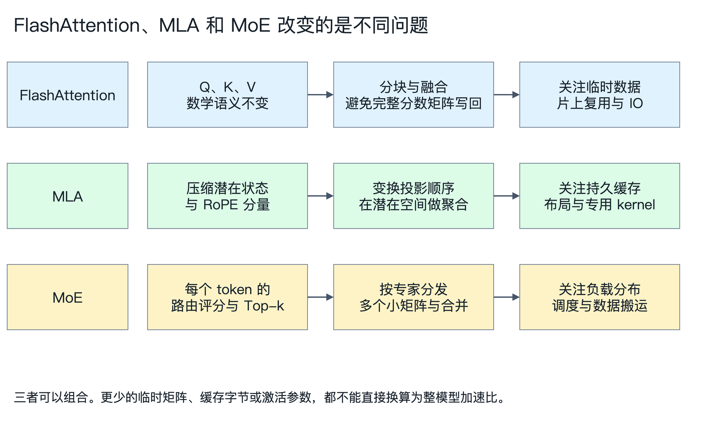
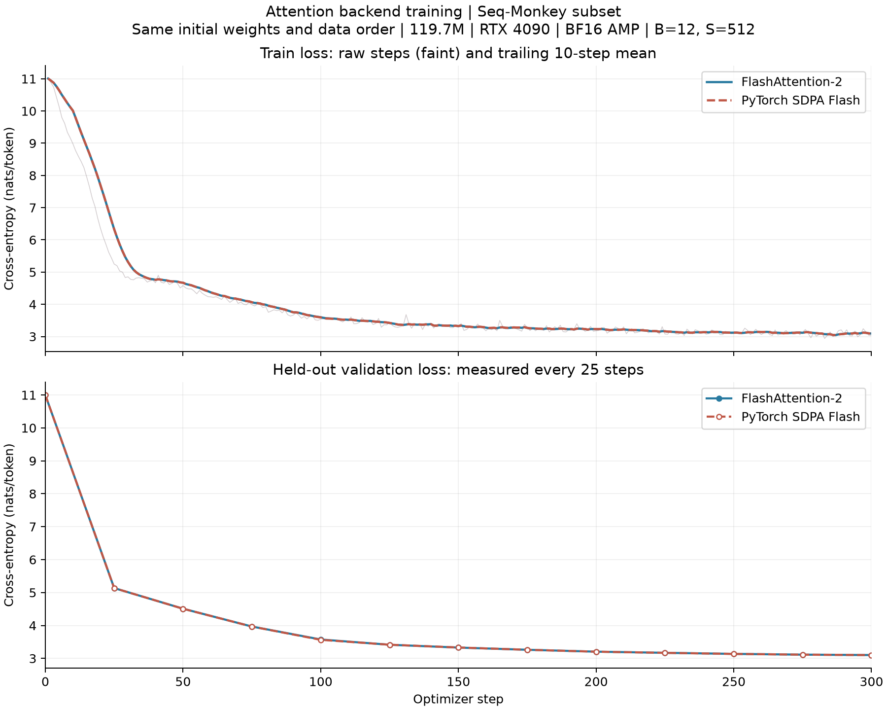
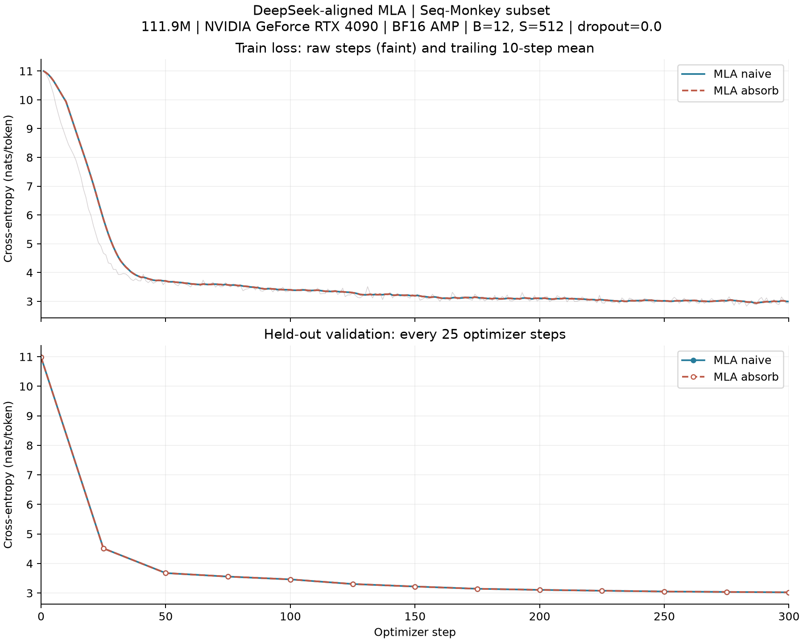
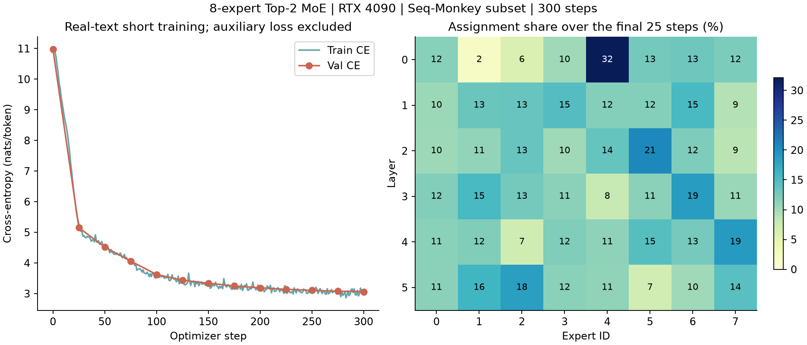

# 从大模型到 AI 芯片 二 从性能分析到 MLA 与 MoE

第一篇把一个小型 Decoder 模型搭了起来，也跑通了短程训练。接下来很容易冒出一个想法：既然模型已经能跑，换上 FlashAttention、MLA 或 MoE，是不是就能更快？

我把这些改动分别做了一遍。结果没有那么整齐：有的改动确实降低了耗时，有的明显减少了缓存，却没有让这份代码更快。最值得记录的不是哪个名字赢了，而是每一次改动，到底改变了什么工作。

这篇仍然从芯片架构看模型。但在讨论 NPU 该加多少算力、放多少 SRAM 之前，得先把执行过程看清楚。否则很容易只凭参数量和 FLOPs 下结论，而那个结论和实际负载往往对不上。

## 一 实验配置

实验模型沿用第一篇的主要尺寸：6 层、隐藏维 768、12 个注意力头、SwiGLU 中间维 2048、词表 50257。Dense 版本约 1.20 亿参数。代码、原始数值和复跑步骤见[配套仓库](https://github.com/Ch1-n/llm-to-ai-chip)。

本篇的推理数据都来自同一张 RTX 4090 24 GB，注意不是第一篇那张 4090 D。推理权重主要用 BF16，关掉 dropout，只算最后一个位置的 LM Head。Prefill 的计时包含新缓存的建立；Decode 在计时外建好前缀，正式计时只处理一个 token。文中的长度都包含当前输入位置。

每次计时前预热，计时后等 GPU 真正做完，取多次测量的中位数。Profiler 单独开一轮采集，不用开了 Profiler 之后的时间做性能排名。没有用 torch.compile、CUDA Graph，也没有用线上推理调度器。

还有一个容易混淆的地方：下面三种技术处理的不是同一个问题。

FlashAttention 主要改变注意力的执行方式，MLA 改变历史状态的表示与相关计算，MoE 则改变每个 token 要执行哪些 FFN。它们可以组合，不是三个互相替代的选项。

## 二 合并多头

最初的教学实现逐个 head 调用 Attention。这样写好读，但每个 head 都要单独走一遍张量操作、单独发起 kernel。先不改注意力公式，只把多个 head 合起来执行，结果如下。

| 工作负载 | 逐 head ms | 合并多头普通实现 ms | FA2 ms |
| --- | ---: | ---: | ---: |
| Prefill B=1 S=512 | 20.432 | 7.527 | 7.117 |
| Prefill B=1 S=2048 | 20.797 | 8.931 | 7.164 |
| Prefill B=8 S=2048 | 60.868 | 63.508 | 22.468 |
| Decode B=1 长度512 | 18.542 | 7.151 | 6.918 |

长度 512、batch=1 时，最明显的变化发生在“逐 head”到“合并多头”这一步。如果只展示改动前后的 20.432 和 7.117 ms，就会把代码组织方式的收益也记到 FlashAttention 头上。

batch=8、长度 2048 时又有不同情况。普通合并实现一次铺开更大的 score 和 probability 张量，峰值 allocated 显存约 2164.8 MiB；FA2 约 791.8 MiB，耗时也明显下降。逐 head 实现的峰值约 792.8 MiB，因为各 head 的大临时矩阵不是同时保留，不能笼统地说“普通 Attention 都会占同样多的显存”。

这组数据提醒我，并行度不是越大越好。合并之后有多少临时数据、这些数据能不能留在片上，同样重要。

## 三 FlashAttention 的取舍

普通实现可以直接写成：

$$
S=QK^T/\sqrt{d},\qquad P=\operatorname{softmax}(S),\qquad O=PV
$$

当序列变长，S 和 P 的规模按序列长度的平方增长。问题不只是计算这些矩阵，还包括它们的写入、读取和存储。

FlashAttention 将注意力按块计算，借助在线 Softmax 更新统计量和输出，不必把完整的 S、P 写回显存。它保持标准注意力的数学语义；浮点运算次序不同，因此不承诺逐位相同。它也不是把模型改成稀疏注意力。

在 B=1、12 heads、head dim=64、序列长 2048 的算子微基准中，普通合并实现前向约 1.067 ms，FA2 约 0.244 ms。但整模型没有得到同样的加速比，因为投影、RoPE、归一化、FFN、缓存和 LM Head 都还在。

对 NPU 架构来说，这里值得关注的是数据复用、片上容量和算子之间的连接方式。只把矩阵乘阵列做快，却把中间张量反复写回外存，未必能得到预期收益。

### 验证到的版本范围

本轮单独测的 FA2 是 flash-attn 2.8.3。PyTorch SDPA Flash 是另一条显式指定的后端，不和独立的 FA2 包混在一起记；测试不允许静默回退到 math。

FA3 面向 Hopper，本机 RTX 4090 不是这一代架构。FA4 则需要分开看版本和执行路径：最初的 PyTorch 2.7 环境缺少它依赖的 dtype，无法导入；换用已有的 PyTorch 2.8 环境后，FA4 4.0.0b36 的两个 BF16 前向形状通过检查，但反向入口拒绝本机 SM89。

因此，这篇没有 FA3 的性能结果，也没有 FA4 的完整训练曲线。不能把“某个前向能运行”写成“这一代算法已经在整模型训练中验证”。具体版本和错误保留在实验记录中，这不是对所有未来版本的兼容性判断。

## 四 真实文本训练

为了确认后端替换没有只停留在前向计时，我沿用第一篇的 Seq-Monkey 中文子集，让 FA2 和 SDPA Flash 各训练 300 步。两组使用同一初始参数、相同训练顺序和固定验证块。

| 指标 | FA2 | SDPA Flash |
| --- | ---: | ---: |
| 初始验证交叉熵 | 10.99762 | 10.99763 |
| 第300步验证交叉熵 | 3.10220 | 3.10086 |
| 最后25步训练交叉熵均值 | 3.08631 | 3.08514 |
| 累计训练 token | 1,843,200 | 1,843,200 |

训练用 FP32 权重和 AdamW 状态、BF16 autocast，batch=12、长度 512、dropout=0.1。基线和之后每 25 步，都在固定的 192 个验证块上验证一次。图里的验证连线只是把实际测量点连起来。

两条曲线很接近，但不能拿最后几千分之一的差异判断训练质量。不同 kernel 的舍入顺序和 dropout 随机数消费方式都可能不同。这里能确认的是，两条路径都完成了真实语料的短程学习，不是说模型已经充分训练。

## 五 MLA 的缓存布局

标准 MHA 通常缓存每个 head 的 K 和 V。忽略元数据，其容量可写成：

$$
M_{\mathrm{MHA}}=2LBTn_hd_hb
$$

L 是层数，B 是 batch，T 是历史长度，n_h 和 d_h 分别是 head 数与 head dim，b 是每个元素的字节数。

MLA 的思路是先把输入映射为较小的潜在状态，再从中得到各 head 需要的 K/V；与 RoPE 有关的 key 分量另外保存。缩小模型中，KV rank=128，独立 RoPE 分量为 32。压缩路径的缓存容量为：

$$
M_{\mathrm{MLA}}=LBT(r_{KV}+d_R)b
$$

本篇并不是把 MHA 的 K/V 随便接一个压缩层。MLA 采用不同的参数化，需要训练。实现参照 DeepSeek-V3 固定版本的官方推理代码，背景见 DeepSeek-V2 报告；缩小维度后，对照官方 naive 和 absorb 两条路径检查输出、缓存、输入梯度及全部参数梯度。

naive 把逐 head 的 K/V 展开后缓存；absorb 只存压缩状态，把一部分投影挪到历史聚合之前或之后。Value 在潜在空间里聚合完，再做上投影。这样就不必为每个历史位置重复展开完整的 V。

在同一组 MLA 参数、B=1、长度 2048 下，得到：

| 路径 | 全部层逻辑缓存 MiB | Prefill ms | Decode ms |
| --- | ---: | ---: | ---: |
| naive | 36.00 | 15.603 | 8.199 |
| absorb | 3.75 | 18.177 | 8.754 |

缓存缩小了 9.6 倍，但这份普通 PyTorch 实现没有更快。两条路径的收缩维度、张量布局和执行顺序不同，通用 einsum 也不是专门的 FlashMLA kernel。这个结果说明容量优势不能直接兑换成当前实现的延迟优势，不说明生产级 MLA 普遍慢。

两条路径也从同一初始化出发，各完成 300 步文本训练，最终验证交叉熵分别为 3.02446 和 3.02416。它们采用 dropout=0，而前面的 MHA 后端训练采用 0.1；模型参数量也不同。因此，不能把约 3.024 和约 3.10 的差距解释为 MLA 质量更好。

## 六 MoE 的执行链

MoE 将 Dense FFN 替换为多个专家，每个 token 由路由器选出少数专家执行。本篇使用 8 个路由专家、Top-2、每个专家中间维 512，不设共享专家、不截断容量、不丢 token。它是便于阅读的逐专家 gather 与 index_add 实现，没有 grouped GEMM。

Dense SwiGLU 的三组主要权重约为：

$$
N_{\mathrm{Dense\ FFN}}=3dh,\qquad N_{\mathrm{active\ experts}}=3dkh_e
$$

这里 d=768、h=2048、k=2、h_e=512，所以每个 token 激活的专家 FFN 权重数是 Dense FFN 的一半。这个比较不包括路由器，也不代表总参数减少：8 个专家仍然要存储。

更重要的是，路由之后还要把 token 按专家分组、执行不同大小的矩阵、把结果加权合回原位置。batch=1 的 Decode 尤其容易出现小任务多、每个专家分不到多少 token 的情况。

在同轮 B=1、长度 2048 的参考实现中，Dense Decode 约 7.310 ms，MoE 约 14.246 ms。MoE 总参数约 1.48 亿，Dense 约 1.20 亿，没有质量匹配。这一对照只能说明：在当前执行路径里，更少的激活权重没有换来更低延迟。

为了不让 MoE 只停留在随机输入计时，我也补了同一 Seq-Monkey 子集的 300 步训练，batch=12、长度 512、dropout=0，使用 FP32 权重和 AdamW、BF16 autocast。主交叉熵之外加入权重 0.01 的负载均衡辅助目标，验证只统计交叉熵。

初始验证交叉熵为 10.97383，第 300 步为 3.06061，最后 25 步训练交叉熵均值为 3.02102。每一步都保留了各层的专家分配数。图中热图统计的是最后 25 步的 assignment 占比；一个 token 会分给两个专家，因此它不是互斥的 token 类别统计。

训练完成不意味着所有专家已经均衡或形成可解释分工。这个约 1.48 亿参数的模型也不能与前面 dropout、参数量均不同的 Dense 和 MLA 直接按 Loss 排名。

## 七 Top-k 与数值路径

MoE 还有一个容易在纯矩阵分析里漏掉的问题。假设第二名和第三名的评分很接近，舍入误差虽然小，却可能改变 Top-2 的第二个专家。接下来执行的是另一组权重，差异就不再只是同一个矩阵乘里的小误差。

首轮随机权重检查中，FP32 的整段和分块推理通过；原生 BF16 下，MoE 与 MLA+MoE 并没有全部满足既定容差。核对逐层专家 ID，确实发现选择变化。为了定位原因，我还用整段前向的专家 ID 重放过分块路径，误差明显缩小。这个重放只是诊断手段，真实推理当然不能提前知道另一条路径的专家选择。

把 router 投影改成 FP32，也不能保证所有选择相同，因为传入 router 的隐藏状态本身可能已经不同。精度策略需要连同离散决策一起验证，不能只给每个线性层设一个误差阈值，就认为整模型没有问题。

补测还加载了训练后的 MoE 权重，用一段 256 token 的真实验证文本比较整段与 127/1/128 分块推理。FP32 最大绝对差约 8.58e-6，没有专家集合变化；原生 BF16、BF16 autocast、原生 BF16 加 FP32 router 分别出现 6、10、7 个层内 token 位置的选择变化，三组最大 logits 绝对差均为 0.4375，没有全部满足既定容差。这里统计可跨层重复计数，不是去重后的文本 token 数。

这是一个有限样本的精度诊断，不说明所有输入都会如此，但也不能把随机初始化时的问题当作训练后自然消失。本文保留这一限制，不宣称 BF16 MoE 缓存推理已经全面对齐。

## 八 任务形状与数据生命周期

在三次固定位置 Decode 的 Profiler 时间线中，逐 head、合并多头普通实现、独立 FA2 分别记录到 3402、1548、1422 个实际 CUDA kernel。这些是任务计数，不是硬件利用率。用户标记和嵌套算子时间不能重复相加，也不能根据时间线空隙就给 CPU 或 GPU 计算单元分配精确的瓶颈百分比。

不过，执行过程已经足够具体了。FlashAttention 让我们看见临时大矩阵与片上复用的重要性；MLA 让我们区分“存了多少”和“怎么读、怎么计算”；MoE 则要求把 token 分发、专家负载和聚合放进性能模型。

对 NPU 来说，这些问题可能落到不同资源上：矩阵阵列处理投影和专家 GEMM，向量或标量路径处理归一化、Softmax、路由与索引，DMA 和存储层次负责把数据及时送到计算单元。是否值得做专用加速，需要先知道任务大小、出现频率，以及它在整条执行链里占多少时间，不能只看算子名字。

下一篇继续看 Hybrid Attention。它不再只是改变缓存表示，还决定哪些历史被保留、压缩和读取。压缩器、Indexer 和 gather 进入执行链之后，计算量和数据访问会怎样变化，我们再用实验拆开看。

## 参考与实验边界

1. 学习起点：[LLMs-Zero-to-Hero](https://github.com/bbruceyuan/LLMs-Zero-to-Hero)，原项目作者 chaofa，Apache-2.0。原始 Notebook 未被覆盖修改。
2. [FlashAttention](https://arxiv.org/abs/2205.14135)、[FlashAttention-2](https://arxiv.org/abs/2307.08691)；具体软件版本和本机支持范围见实验记录。
3. [DeepSeek-V2](https://arxiv.org/abs/2405.04434)、[DeepSeek-V3 固定版源码](https://github.com/deepseek-ai/DeepSeek-V3/blob/b15f0dbbbe6a4bc403306175698439ef380f5fb5/inference/model.py)。上游参考代码保留 MIT 许可证。
4. [第二篇性能与精度记录](../experiments/chapter02-rtx4090-20261025.md)、[FA2/SDPA 训练](../experiments/seq-monkey-attention-backends-300.md)、[MLA 训练与官方对照](../experiments/mla-reference-20261101.md)。
5. [MoE 文本训练与训练后精度补测](../experiments/moe-text-20261101.md)。

所有模型都是缩小的实验模型。300 步训练不构成充分预训练；验证集用于观察和选择权重，没有额外独立测试集。性能表不等于生产内核上限，也未覆盖跨卡专家通信。语料使用有限子集，来源和划分局限保留在仓库，不重新分发原始语料与模型权重。
