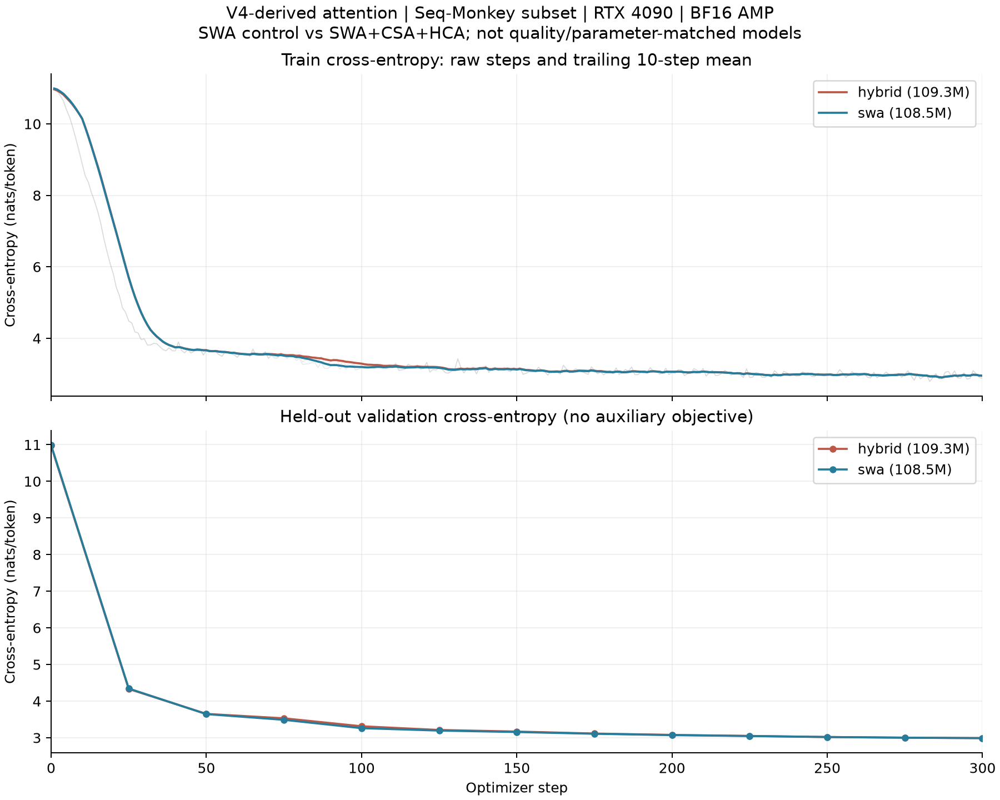
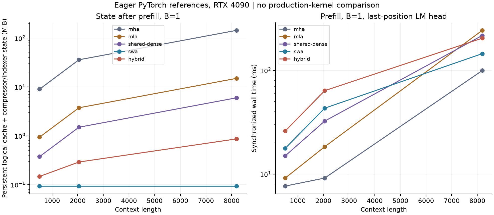

# 第三篇首轮实验：Hybrid Attention 的状态与执行开销

日期：2026-11-01。设备：RTX 4090 24 GB；PyTorch 2.8.0+cu128。复用服务器已有的独立环境，没有修改基础环境。本轮代码、日志、权重和时间线已回收到本地。GitHub 只发布代码、文档、配图和可公开的数值记录；语料、权重及完整时间线另存本地。

后续已完成[补充实验](chapter03-supplement-20261101.md)：训练后长序列、连续 Decode、消融和相同验证后缀的历史长度观察。下文保留首轮的测量范围；新增一组 BF16 增量对照未全部满足原容差，不宣称全面通过。

这轮想弄清楚两件事：滑动窗口、压缩和选择分别改变了什么状态；这些变化在一个没有融合优化的实现里，会带来哪些额外工作。结果先说明一个很实际的问题：**缓存缩小，不等于单 token 延迟就会下降。**

## 1. 固定实现，而不是泛指 Hybrid Attention

采用 [DeepSeek-V4-Flash](https://huggingface.co/deepseek-ai/DeepSeek-V4-Flash/blob/60d8d70770c6776ff598c94bb586a859a38244f1/inference/model.py) 的注意力结构，固定 revision `60d8d70770c6776ff598c94bb586a859a38244f1`，对应[技术报告第 2.3 节](https://arxiv.org/html/2606.19348)。另用固定版 Transformers 的密集 eager Attention 核心作独立对照。原始文件、许可证、哈希和适配说明见 [references/deepseek-v4](../references/deepseek-v4/)。

缩小配置为 6 层、隐藏维 768、12 heads、head dim 64、Dense SwiGLU 中间维 2048，词表 50257。局部窗口为 128，Hybrid 各层压缩比为 `0,0,4,128,4,128`：

- SWA：只读取局部窗口。
- CSA：压缩比 4，使用相邻窗口的重叠压缩，由 Indexer 选择历史压缩块。
- HCA：压缩比 128，读取重压缩后的历史，不做 Indexer 选择。

保留共享 K=V、低秩 Q、分组低秩 O、输出逆 RoPE 和 attention sink；Indexer top-k 缩小为 8。未实现量化、YaRN、MoE、mHC、MTP、Muon 或生产级 FlashMLA/TileLang 内核，也没有加载完整 V4 权重。

同分选择有一个明确改动：用稳定排序，让较小的压缩块 ID 优先。原始普通 top-k 不保证同分顺序，可能使整段和增量路径选中不同块。这里为可核对性规定顺序；不将 stable argsort 的速度等同于官方优化选择器。

## 2. 先核对计算，再计时

本地全套单元测试 **46 项通过**，其中第三篇 9 项。CUDA 检查另有 **8 条记录全部通过**，包括：

- 未量化的官方 Attention/压缩缓存，覆盖压缩比 0、4、128。
- gather 核心与独立 Transformers 密集掩码核心的输出及 Q/KV/sink 梯度。
- 实际教学维度的 SWA/Hybrid，FP32 和原生 BF16 下的因果性、整段/分块缓存一致性。

官方参考适配关闭量化模拟，省略同时作用于 Indexer Q/K 的正交 Hadamard 变换，以独立密集核心替代 TileLang 稀疏 kernel，并明确统一同分策略。不是直接跑未经修改的完整官方模型。

CUDA 实际维度检查序列长 137，跨过压缩比 4/128 的边界；单元测试也覆盖未完成块的可见性。**尚未对训练后的 checkpoint 做长上下文缓存一致性和长文本质量评估**，也未穷举所有分块方式。检查原始数值见 [checks.json](../data/chapter03/20261101/checks.json)。

## 3. 两组真实文本短程训练

沿用前两篇 Seq-Monkey 有限子集的文档划分、训练顺序和验证块。两组各训练 300 步，batch=12、序列长 512，累计各 1,843,200 token。每 25 步在固定 192 个 held-out blocks 上验证一次，另有训练前基线。

权重和 AdamW 状态为 FP32，采用 BF16 autocast；压缩累积和 Softmax 使用 FP32。没有 dropout。两组参数量和初始权重不完全相同，不能作为质量匹配后的架构排名。

| 指标 | SWA | Hybrid |
| --- | ---: | ---: |
| 参数量 | 108,466,632 | 109,310,216 |
| 初始验证交叉熵 | 10.987809 | 10.968812 |
| 第 300 步验证交叉熵 | 2.990144 | 2.990170 |
| 最后 25 步训练交叉熵均值 | 2.946589 | 2.945561 |
| 前 10 步后模型训练步中位数 | 114.22 ms | 150.00 ms |
| 训练循环用时，含验证和保存 | 51.58 s | 64.11 s |
| 峰值 allocated 显存 | 7.97 GiB | 8.16 GiB |



图中训练线是每步交叉熵，验证线连接离散评估点。两条验证曲线几乎重合，只能说明这个小配置在短序列上能学习，不能据此推断长上下文能力，也不能宣称 Hybrid 没有效果。

Indexer 的硬选择不可微，因此额外加入教学用 KL 蒸馏目标：以 detach 后的主注意力对全部已完成压缩块的概率监督 Indexer，权重 0.01。日志将交叉熵、辅助损失和 Indexer 梯度分开记录，验证只报告交叉熵。Hybrid 每步都有非零 Indexer 梯度，但这不等于验证了选择质量，更不代表复现官方完整训练策略。

两组各有 300 条训练、13 条验证记录，见 [Hybrid 数据](../data/chapter03/20261101/train-hybrid/)和 [SWA 数据](../data/chapter03/20261101/train-swa/)。最佳 checkpoint 不含优化器和 RNG 状态，不能精确断点续训。

## 4. 缓存变小，参考实现却没有更快

扫描 MHA、MLA、shared-dense、SWA、Hybrid 五种结构，batch=1/4，上下文 512/2048/8192，分别测 Prefill 与单 token Decode。按预先限定的范围跳过 batch>1 且上下文>2048 的 10 项，**50 项完成，0 项失败**。每项预热 2 次、计时 5 次，报告同步 wall time 中位数，不在 Profiler 内计时。

这里的 context 指**处理本次输入后累计的 token 数**。例如 Decode context=8192，先在计时外建立 8191 token 的前缀，再计时处理第 8192 个 token。前缀建立和缓存位置恢复对所有结构均不计时。Prefill 则包含新缓存建立，两种阶段都只计算最后一个位置的 LM Head。

下面是 batch=1、累计 8192 token 的实测：

| 结构 | Prefill ms | Decode ms | 持久逻辑状态 MiB | Prefill 峰值 allocated MiB |
| --- | ---: | ---: | ---: | ---: |
| MHA | 99.50 | 7.31 | 144.000 | 3619.37 |
| MLA | 242.61 | 8.76 | 15.000 | 8050.93 |
| shared-dense | 216.60 | 10.18 | 6.000 | 416.73 |
| SWA | 144.74 | 10.81 | 0.094 | 359.94 |
| Hybrid | 203.97 | 16.06 | 0.865 | 362.32 |



shared-dense 使用与 Hybrid 相同的新投影和共享 K=V 结构，但保留全部历史。因此从 6 MiB 到 0.865 MiB 的比较，比直接用 MHA 的 144 MiB 作基线更容易分清窗口和压缩的作用。MHA 到 Hybrid 的变化混合了 head 共享、K=V、窗口、压缩等因素，不能全部归功于压缩。

Hybrid 的状态统计包含局部 K=V、主压缩历史、Indexer 压缩历史，以及压缩器的 FP32 未完成块和重叠状态，不只是压缩后的 KV 载荷。记录同时保存有效逻辑字节和去重后的实际 tensor storage；本表这些边界位置的两者一致。临时工作区、权重和 allocator 缓存不是同一口径，峰值显存不能直接称为 KV Cache 大小。

**这不是生产内核性能排行。** 所有模型使用随机权重，未做质量或参数量匹配；MHA/MLA 使用显式完整 score 矩阵，新路径沿 query 维分块，峰值显存和 Prefill 时间因此还包含实现方式的差异。新路径是 eager PyTorch、未融合的压缩/排序/gather；不能拿这张表推断优化后的 FlashMLA、FlashAttention 或实际 DeepSeek 模型速度。原始数据见 [benchmarks.jsonl](../data/chapter03/20261101/benchmarks.jsonl)。

## 5. 别只测恰好闭合压缩块的位置

主扫描长度都是 128 的倍数，Hybrid 的单 token Decode 正好完成 CSA 和 HCA 的压缩块。补测相邻位置，batch=1，预热 3 次、计时 10 次：

| 本次处理后累计 token 数 | SWA ms | Hybrid ms |
| --- | ---: | ---: |
| 511 | 10.90 | 13.37 |
| 512 | 10.96 | 16.10 |
| 513 | 10.81 | 13.37 |

Hybrid 在 512 位置比两侧约高 20%，而 SWA 变化很小。这是当前参考实现的边界开销，不是所有 token 的平均延迟。要评估稳定吞吐和尾延迟，还需要覆盖完整压缩周期、不同 batch 和实际生成过程。本轮先保留这个可观察的差异，见 [boundary.jsonl](../data/chapter03/20261101/boundary.jsonl)。

另为三个场景各记录 3 次 Decode 的时间线：

| 场景 | 累计 token 位置 | 三次调用实际 CUDA kernel 数 |
| --- | ---: | ---: |
| SWA | 512 | 2253 |
| Hybrid，非闭合位置 | 513 | 2709 |
| Hybrid，闭合位置 | 512 | 3357 |

这里每次都恢复同一个前缀位置，不是连续生成三个 token。统计只计算 trace 中的实际 kernel 事件，不把 GPU 标注或嵌套算子时间重复相加。Profiler 会明显改变执行时间，因此这个表用于观察任务数量和时间线，不替代延迟表。它也没有给出 Tensor Core、SFU 利用率或真实带宽，不能用 kernel 区间覆盖率冒充硬件利用率。对应摘要位于 [实验数据目录](../data/chapter03/20261101/)。

## 6. 接下来文章可以讨论什么

这轮数据能支撑讨论局部窗口的有限状态、压缩状态的更新周期、Indexer 的评分与选择、gather 的不规则读，以及矩阵计算之外的小任务。对 NPU 来说，需要考虑的不只是压缩比，还包括这些任务如何分工、是否融合、临时数据放在哪里，以及闭合压缩块时是否出现突发工作。

但目前没有硬件计数器，不能把慢下来的时间准确分摊为 CPU 发起、访存或某个计算单元不足。也没有长上下文质量实验，不能只凭显存曲线选择模型结构。后续优化应先固定数学语义，再逐步替换实现，保持状态口径和计时范围一致。

## 7. 复跑与本地归档

命令、配置、依赖和验证适配见 [运行说明](chapter03-runbook.md)。可公开日志保存在 `data/chapter03/20261101/`，大文件保存在本地 `runs/chapter03-20261101/`，包括两组权重、完整 trace、冻结依赖与源码快照。语料继续引用本地前两篇的同一子集，没有重新下载或替换。

本地完整性验证见 [verification.json](../data/chapter03/20261101/verification.json)：核对了语料哈希、训练顺序、验证块、源码指纹、日志完整性和权重有限性。两份 checkpoint 的本地 SHA256 与服务器原件一致：

```text
Hybrid: 61110d6540ef886c6edce1d414e13d68e69b30e6b9d0661a0fdcd91b6e7a0ca0
SWA:    049023ef91345af40fc71e156e3eae3c0f9bcd074547a14f3abba60a878dbe48
```

实际测量用源码保留为 `source-measured.tar.gz`，SHA256 为 `5d28d7a83a95d90fb0a40ccb499e7fa66fd1657858db85623568c98270b4197b`。测量后只修正了核验工具对 JSON list/tuple 的比较，并增加同分排序的回归测试；没有据此改动模型计算或重写原始结果。最终工具和文档另存为 `source-final-20261101.tar.gz`，不覆盖测量快照。
