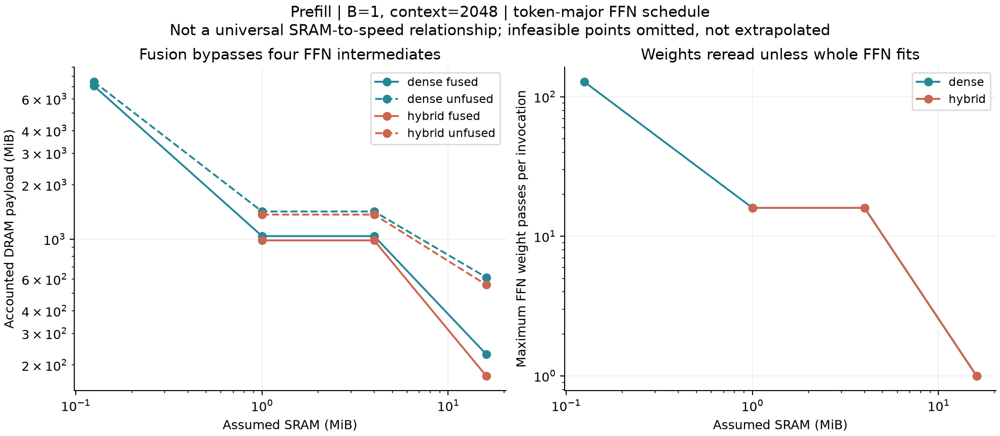
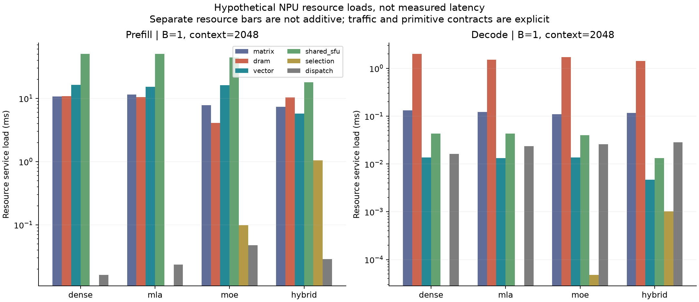
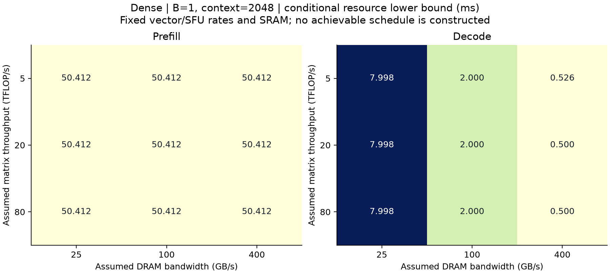
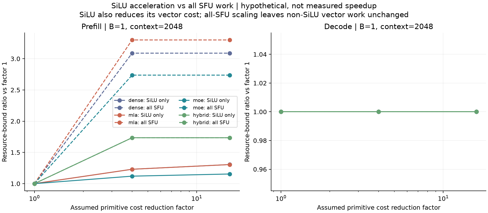

# 第四篇配套分析 从推理工作负载到 NPU 架构

日期：2026-11-01。这轮没有启动 GPU 服务器，也没有新增训练。分析器在 Mac 的 CPU 上运行，核心只依赖 Python 3.11 及以上版本的标准库。

目标是把前三篇的模型转成一份能复查的工作量和数据流量清单，再改变硬件假设，观察限制条件如何变化。**下面的时间全部来自解析模型，不是 RTX 4090 实测，也不是实际 NPU 或 SystemC 仿真结果。** 没有拿前几篇未融合代码的延迟拟合某款 NPU。

## 一 分析了哪些模型

| 变体 | 参数量 | 注意力及 FFN |
| --- | ---: | --- |
| Dense | 119,690,496 | MHA 与 Dense SwiGLU |
| MLA | 111,858,432 | 第二篇官方对齐的 absorbed MLA 与 Dense SwiGLU |
| MoE | 148,038,912 | MHA 与 8 专家 Top-2 SwiGLU |
| Hybrid | 109,310,216 | 第三篇缩小的 SWA/SWA/CSA/HCA/CSA/HCA 与 Dense SwiGLU |

参数直接复用 `tools/chapter02/config.py` 和 `tools/chapter03/config.py`，不会另造一套同名模型。详细尺寸和源码 SHA256 保存在 [metadata.json](../data/chapter04/20261101/metadata.json)。

默认扫描 batch=1/4/16，长度 512/2048/8192，分别计算 Prefill 和 Decode。Prefill 从空历史开始；Decode 长度包含当前 token。只计算最后一个位置的 LM Head，不计算采样。MoE 默认用一个可复现的均衡分发规则，并额外对照集中到 k 个专家的分发规则，不冒充真实 router 的选择。

共有 72 条基线、392 条单因素扫描、18 条算力与带宽网格、64 条 SRAM/融合对照记录。后两种扫描与前面的部分配置重复。SRAM 约束下不可行的记录分别为 6/12 条，保留原因，不填成零延迟，也不将其计为已经执行成功的硬件配置。

## 二 工作量如何计算

每个模型被拆成带前驱依赖的逻辑操作，清单包括：

- 线性投影、QK、PV、SwiGLU 三组矩阵，以及 MLA 的吸收投影和潜在空间聚合。
- SiLU 元素数、Softmax 元素和行数、归一化行数，以及 exp、倒数、rsqrt 的需求。
- Hybrid 压缩投影、gate/pooling、Indexer 评分、候选选择和状态读写。
- MoE router、分发、专家执行及聚合。

线性层保存 M/N/K/group 形状；SiLU、归一化和 Softmax 保存逻辑元素规模。普通 Attention 使用因果有效项数量，Prefill 每个 head 的配对数为 T(T+1)/2；Decode 为当前可见长度。Hybrid 逐位置计算局部窗口、已完成压缩块和最多 k 个选择项，不让未完成块提前可见。

这与第一篇把普通 dense Attention 的完整掩码矩阵也计入 FLOPs 的口径不同。它描述目标硬件可以跳过无效项时的有用工作，不是前三篇 PyTorch 实际发出的全部运算。

一次乘加按 2 FLOPs。显式线性层按假设阵列的 M/N/K tile 取整，Attention/Indexer 的 tile 浪费没有进一步建模。默认阵列 tile 为 16×16×16，不是 GPU Tensor Core 的硬件描述。

非矩阵工作也有明确的实现假设。SiLU 采用 exp、倒数和逐元素算术的分解；Softmax 使用行最大值、减法、exp、求和、行倒数和缩放；RMSNorm 每行使用一次 rsqrt。RoPE 的 sin/cos 表假设预计算。这些是基本算术的预算，不是实际 ISA 指令条数，也没有验证 LUT 或多项式近似的误差。

## 三 容量与流量分开统计

`logical_state_bytes` 是处理完当前输入后仍要保留的状态。Hybrid 中包括局部 K=V、压缩历史、Indexer 历史和 FP32 的未完成/重叠压缩状态。

`dram_payload_bytes` 则是当前调用在选定数据流下的字节账目，包括权重读取、状态读写、FFN 边界及指定的中间张量搬运。不能拿缓存容量直接代替一次调用的访存量。

主要假设如下：

- 每次调用不跨请求常驻投影权重；非 FFN 权重在本次调用内理想地读一次。
- Attention 使用片上 score/probability 及有利的数据复用，不计完整分数矩阵写回、query 分块导致的重复 KV 读取、其他非 FFN 中间结果或残差 spill。
- Decode 的同一批 item 不共享历史；MLA 潜在状态在 QK/PV 之间复用。Hybrid 的选中向量按从 DRAM 读取计费，即使某个向量刚刚生成。这是指定的保守选择，不是读取下界的完整证明。
- Hybrid 的 FP32 压缩缓冲常驻 SRAM，Prefill 结束也不额外写回 DRAM；为所有层预留一个完整待完成块及必要重叠状态。如果预留已经耗尽 SRAM，标为不可行，暂不模拟 spill。

以上没有构造一个保证可实现的完整数据流，因此输出的条件资源下界不能理解为某款芯片的绝对物理下界。尤其是 Attention、残差和层间数据的完整活跃区间还没有通过容量校验，不能凭 FFN 分块能放下，就宣称整个模型可以这样执行。

## 四 SRAM 与 SwiGLU 融合

这部分没有简单乘一个“融合系数”，而是给出一个具体、仍然简化的 token-major 方案。

每次处理 m 个 token 和 n 个 FFN 中间通道，保留输入块、gate/up 缓冲和 FP32 的 down 输出累加器。SiLU 和逐元素乘法原地使用中间缓冲。基本工作集是：

```text
3*d*n*b             三组权重块
m*d*b               输入块
2*m*n*b             gate/up 缓冲
4*m*d               FP32 输出累加器
```

如果三组完整 FFN 权重加激活缓冲能放进可用 SRAM，就在这一次 FFN 调用内保留权重；否则每个 token 块重读一遍权重。分块器枚举设定上限不断减半后的 M/N 候选，先减少权重重读次数，再优先较大的 M/N，不声称得到最短延迟的调度。

unfused 对照保持同样的权重读取计划，只额外写回并读入 gate、up、SiLU 和 gated product 四份中间张量，增加 8×M×H×b 字节。它不是最优独立 GEMM 实现与最优融合实现的全面比较；改变循环顺序、重算或部分累加写回，会得到其他权衡。

例如 Dense、Prefill、B=1、T=2048 的假设账目：

| SRAM MiB | FFN 权重最多读取遍数 | fused 流量 MiB | unfused 流量 MiB |
| --- | ---: | ---: | ---: |
| 0.125 | 128 | 7087.673 | 7471.673 |
| 1 | 16 | 1039.673 | 1423.673 |
| 4 | 16 | 1039.673 | 1423.673 |
| 16 | 1 | 229.673 | 613.673 |

这里 1 MiB 和 4 MiB 的权重遍数相同，不意味着增加 SRAM 永远无效；它只是这个分块上限和选择规则下的结果。也不能把 16 MiB 的较低流量直接换算成同等幅度的加速。



## 五 怎样使用硬件参数

[示例硬件配置](chapter04-example-hardware.json)是一组人为设定值，不对应任何产品：BF16 类矩阵算力 20 TFLOP/s、FP32 矩阵算力 5 TFLOP/s、带宽 100 GB/s、SRAM 4 MiB。基本向量吞吐为每秒 64G 次预算操作，exp/倒数/rsqrt 分别设为每秒 4G/4G/1G 个元素，候选选择每秒扫描 1G 项，逻辑命令发起开销 0.2 us。

矩阵的两种精度共享阵列资源；exp、倒数和 rsqrt 共享 SFU 预算。压缩投影使用 FP32 算力档位。所有层和专家共用同一组资源，不模拟多核专家并行或跨卡通信。

对每类资源求总服务需求，再取最大值：

```text
条件资源下界 = max(矩阵服务量, DRAM服务量, 向量服务量,
                  共享SFU服务量, 候选选择服务量, 命令发起服务量)
```

不同资源可以重叠，所以这些项不能直接相加。这个最大值只是给定账目和吞吐假设下的必要资源时间，没有证明能达到。

另外保存两种参考预算：按完整逻辑 stage 设屏障的依赖路径，以及所有 stage 顺序执行的预算。它们不允许生产者/消费者按 tile 提前流水，算子内部服务量又采用理想重叠，因此**都不是实际延迟保证，串行预算也不是真实执行时间的上界**。当前没有事件调度器、总线争用、bank 冲突、DMA 启动或硬件效率标定。



## 六 这组假设得到什么观察

下面只摘出 B=1、T=2048 的解析结果。单位是模型账目里的 ms，不是硬件实测。

| 模型 | Prefill 条件资源下界 | Decode 条件资源下界 | 本配置下最大资源项 |
| --- | ---: | ---: | --- |
| Dense | 50.411521 | 1.999549 | Prefill 为 SFU，Decode 为 DRAM |
| MLA | 50.436097 | 1.504742 | Prefill 为 SFU，Decode 为 DRAM |
| MoE | 44.150785 | 1.717724 | Prefill 为 SFU，Decode 为 DRAM |
| Hybrid | 17.904593 | 1.416160 | Prefill 为 SFU，Decode 为 DRAM |

这不是四种架构的性能排行。参数量、功能和训练质量不同；数据复用、MoE 分发和矩阵 padding 也都是指定假设，不能把第三篇 GPU eager 路径的排行拿来校准或反驳这个表。

把矩阵算力从 5 扫到 80 TFLOP/s、带宽从 25 扫到 400 GB/s，默认 Prefill 的资源下界几乎不变，因为设定的 SFU 吞吐已经是最大项。图上相同的数字不是“Prefill 不需要矩阵算力”，而是提醒我们检查固定了哪些其他资源。



关于专用激活单元，单独把 SiLU 基本操作成本降低到 1/16，Dense Prefill 的条件资源下界由约 50.412 降到 38.615 ms；如果所有 SFU 基本操作成本都降低到 1/4，下界降到约 16.320 ms，之后向量工作成为限制。默认 Decode 仍由搬运限制，两种改动都没有改善资源下界。

Hybrid 的注意力工作量更小，单独降低 SiLU 成本也会较早触及 DRAM 限制。这说明“值不值得加速激活函数”不能只看一个函数的元素数，还要看其他非线性、数据搬运和吞吐配置。**下界的变化不等于实际加速比**，更没有证明某种激活硬件的面积、功耗或数值误差可以接受。



## 七 运行与核验

核心无需 PyTorch、GPU 或联网，以下命令在仓库根目录执行，输出必须是新的空目录：

```bash
python3 -m tools.chapter04.run \
  --hardware experiments/chapter04-example-hardware.json \
  --contexts 512 2048 8192 --batches 1 4 16 --output runs/ch04-new
python3 -m unittest discover -s tests -p 'test_chapter04.py' -v
```

修改 JSON 可以改变硬件参数。`--token-tile`、`--hidden-tile`、`--ffn-mode`、`--route-policy` 可改变基线的数据流；额外扫描仍使用文档规定的固定轴值，不能把它当成自动寻优器。

正式数据的核验和绘图：

```bash
python3 -m tools.chapter04.verify --data data/chapter04/20261101
python3 -m pip install -r requirements-chapter04.txt
python3 -m tools.chapter04.plot --data data/chapter04/20261101 \
  --output articles/images/llm-npu-architecture
```

绘图脚本依赖 NumPy/Matplotlib，并固定展示默认扫描中的 B=1、T=2048；自定义输出如果不包含这个点，需要调整绘图选择条件。核验脚本使用前几篇随仓库分发的数据作比较，默认验证的是本次正式网格，不是任意自定义长度。

输出文件包括：

- [baseline.csv](../data/chapter04/20261101/baseline.csv)和 [baseline.json](../data/chapter04/20261101/baseline.json)：72 条基线汇总。
- [operator-inventory.json](../data/chapter04/20261101/operator-inventory.json)：8 个代表 case 的逐算子形状、依赖、工作量、状态及 FFN 分块。
- [sensitivity.json](../data/chapter04/20261101/sensitivity.json)：单因素扫描及不可行原因。
- [sram-fusion.json](../data/chapter04/20261101/sram-fusion.json)：SRAM、融合和 batch 的指定数据流对照。
- [verification.json](../data/chapter04/20261101/verification.json)：源码指纹、数据哈希和前文状态容量对照结果。

四个模型参数量对上既有实现；18 条缓存容量与第三篇实际 tensor 状态统计一致；Dense、B=1、长度512的 Decode 矩阵 FLOPs 与第一篇估算一致。新增测试覆盖因果配对、压缩边界、路由分发、SRAM 约束、融合字节账目、padding 和资源预算。这些检查只验证账目和实现一致性，不代表已经验证某个 NPU 的精度、性能或可实现性。

## 八 正文与后续验证

第四篇[正文](../articles/llm-npu-architecture.md)已整理完成，按应用场景、任务形状、资源预算、容量与流量、SRAM 与融合、激活与归约、任务调度展开。本地另保留知乎 Word 版。这里的数据支持算例和敏感性讨论，但还不能给出芯片资源的最优配比。

如果继续进入实现，需要另做激活近似误差、RTL 综合及流水约束验证，并把一条明确的数据流接入事件级或 SystemC 模型。实际访存次数、片上容量活跃区间、资源竞争和并行流水，都还需要那一层验证。前三篇的 BF16 路由/选择未通过项也没有因为这轮解析分析而得到解决。

## 参考

- Williams、Waterman、Patterson，2009，[Roofline An Insightful Visual Performance Model for Multicore Architectures](https://doi.org/10.1145/1498765.1498785)。本轮使用计算/流量的基本资源预算思路，另加入自定义向量、SFU、选择和发起成本，不将这些假设称为原论文提供的 NPU 模型。
- 模型公式和实现版本沿用前几篇，见[来源与范围](../SOURCES.md)、[第二篇实验](chapter02-rtx4090-20261025.md)与[第三篇补测](chapter03-supplement-20261101.md)。
