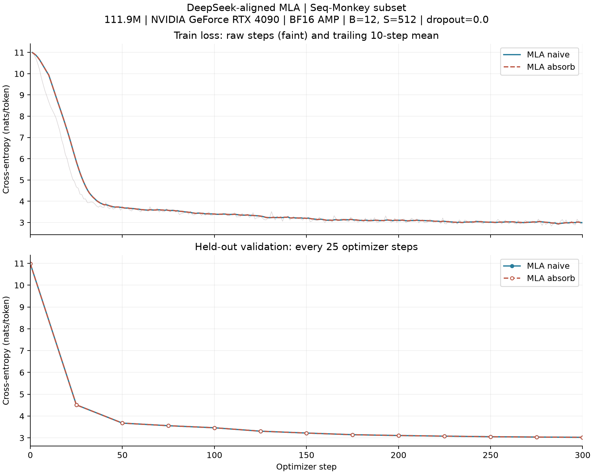

# MLA：官方路径核对与真实语料训练

本记录补齐第二篇的 MLA 实验。`naive` 的 300 步训练于 2026-10-25 完成；2026-11-01 恢复同一台 RTX 4090 后核实已有结果，保持训练源码不变，完成 `absorb` 训练。随后另做实际维度的官方对照、完整模型缓存检查和一组推理计时。原来的三路径教学实验及其数据保持不变。

## 对照的是哪一份实现

以 [DeepSeek-V3 官方 inference/model.py](https://github.com/deepseek-ai/DeepSeek-V3/blob/b15f0dbbbe6a4bc403306175698439ef380f5fb5/inference/model.py) 为参照，固定 commit `b15f0dbbbe6a4bc403306175698439ef380f5fb5`，保留源码与 MIT 许可，见 [来源目录](../references/deepseek-v3/)。数学背景为 [DeepSeek-V2 报告第 2.1 节和附录 C](https://arxiv.org/html/2405.04434v5)。

检查工具按 AST 提取上游原始的 MLA、Linear、RMSNorm 和 RoPE 等定义，不改写这些类，再把我们的随机权重直接载入上游类。固定 `world_size=1`，使用未量化权重；不执行上游文件的顶层 kernel 导入，不加载 DeepSeek 官方模型权重。

新增 `mla-reference-naive` 与 `mla-reference-absorb` 两个变体，参数名称和布局相同：

- `naive`：使用合并的 `wkv_b` 上投影，计算并缓存逐 head 展开的 K/V。
- `absorb`：直接用共享压缩状态和独立的 RoPE key 分量计算 score，先在潜在空间聚合 Value，再做上投影。代码不再显式沿 head 维复制完整历史压缩状态，但普通 einsum 仍可能有内部重排与临时张量。
- 两者均保留上游的 FP32 Softmax，以及在 FP32 中旋转后再转回输入精度的 RoPE。关闭缓存时保留完整计算图，用于训练。

这是**与官方核心路径对齐的缩小模型**，不是完整 DeepSeek-V3 复现，也不是 FlashMLA。此次未验证 FP8、张量并行、YaRN 长上下文缩放或 `q_lora_rank=0` 分支。

## 数值核对

| 检查 | 范围 | 结果 |
| --- | --- | --- |
| 小规模官方对照 | 128 隐藏维、2 heads；FP32/BF16 缓存推理、FP32/BF16 AMP 梯度 | 30 条记录通过 |
| 实际维度官方对照 | 768 隐藏维、12 heads、Q/KV rank=128，其他维度与训练一致 | 30 条记录通过 |
| 完整 6 层模型缓存一致性 | FP32；两条路径，各检查 cat/static | 4 条记录通过 |
| 完整 6 层模型缓存一致性 | 原生 BF16 权重；两条路径，各检查 cat/static | 4 条记录通过 |

官方对照包含整段前向、`5/1/11` 分块和逐 token 前向，比较输出与缓存；另比较输入梯度、全部参数梯度，以及 `naive/absorb` 的代数等价性。每条记录可能包含多次 tensor 比较，不将 60 条记录说成覆盖全部形状。

完整模型另使用 33 个随机 token，对照整段与 `17/1/15` 分块。FP32 最大绝对误差约 4.29e-6；原生 BF16 的最大绝对差分别为 0.05859 和 0.06250，相对 L2 约 2.1%，满足事前设置的 BF16 容差，但不是逐位一致。这与训练时的“FP32 权重、BF16 autocast”是不同精度设置。

检查用的是随机权重，序列较短，不是官方预训练权重的能力评测或长上下文全面验证。原始误差与容差见 [数据目录](../data/mla-reference/)。

## 真实语料训练



两条路径从相同的初始参数开始，使用同一份 Seq-Monkey 中文子集、相同训练块顺序和固定验证块。训练集 4,259,581 token，验证集 203,545 token；本地 token 文件哈希仍与第一篇一致。语料来源、文档级划分、分词和数据局限见[第一篇训练记录](seq-monkey-300.md)。

模型为 111,858,432 参数、6 层、隐藏维 768、12 heads、Q/KV 压缩维 128、非 RoPE/RoPE 通道各 32、Value 通道 64、SwiGLU 中间维 2048。配置特意缩小，没有直接采用 DeepSeek-V3 的生产参数规模。

训练设置：FP32 权重和 AdamW 状态、BF16 autocast，B=12、S=512、dropout=0；前 20 步 warmup 到 3e-4，再 cosine 降到 3e-5，weight decay=0.01、梯度范数裁剪 1。每步检查 Loss 和梯度范数是否有限。

每条路径训练 300 步，共处理 1,843,200 token；基线及每 25 步评估固定的 192 个验证块，每次共 98,304 token。验证集不参与梯度更新，但用于选择最佳权重，没有额外独立测试集。

| 指标 | naive | absorb |
| --- | ---: | ---: |
| 初始验证 Loss | 10.98349 | 10.98359 |
| 第 300 步验证 Loss | 3.02446 | 3.02416 |
| 最后 25 步平均训练 Loss | 2.98734 | 2.98723 |
| 有效训练记录 | 300 | 300 |
| 有效验证记录 | 13 | 13 |

图中淡线是每步训练 Loss，粗线是包含当前点的 10 步尾随均值；验证标记之间只是连线，不是额外测量点。两条曲线非常接近，说明这两条路径都能完成该小模型的短程学习，不代表充分预训练或统计意义上的训练质量等价。BF16 运算次序不同，也不要求最终权重逐位一致。

不能拿这里约 3.024 的 Loss 与前面 MHA 实验约 3.10 的 Loss，直接推导出 MLA 的质量更好：两者参数量、初始化、dropout 和执行代码均有差异。前面的 MHA 使用 dropout=0.1，这里为 0。

## 推理计时

在 2026-11-01 的同一环境，使用相同初始化的随机权重，B=1、上下文长度 2048、BF16、静态缓存，预热 5 次、计时 20 次，得到如下同步墙钟中位数：

| 路径 | Prefill ms | 单 token Decode ms | 全部层逻辑缓存 MiB |
| --- | ---: | ---: | ---: |
| naive | 15.603 | 8.199 | 36.00 |
| absorb | 18.177 | 8.754 | 3.75 |

计时包含 Python 发起与分配等开销，没有启用 compile、CUDA Graph 或 FlashMLA。Prefill 包含新缓存的分配与写入；Decode 在计时外建立前缀，每次恢复到相同逻辑长度。两条路径均只计算最后一个位置的 LM Head。

缓存仍减少了 9.6 倍，但这个 batch=1 的参考实现没有更快。两条 score 路径、收缩维度、kernel 数量和主机发起开销都可能影响结果；未通过硬件计数器定位各自占比，因此不把差异直接归因于某个硬件瓶颈，也不据此断言 MLA 在生产环境中更慢。

## 复现与归档

- [参考组件](../tools/chapter02/mla_reference.py)、[官方对照工具](../tools/chapter02/check_mla_reference.py)。
- [naive 训练配置与逐步记录](../data/mla-reference/naive/)、[absorb 训练配置与逐步记录](../data/mla-reference/absorb/)。
- [日志、权重与源码完整性检查](../data/mla-reference/verification.json)。
- [曲线绘图工具](../tools/chapter02/plot_mla_training.py)、[下载结果校验工具](../tools/chapter02/verify_mla_training.py)。

示例命令在仓库根目录执行，运行目录必须为空：

```bash
python -m tools.chapter02.check_mla_reference --device cuda --preset teaching \
  --output runs/mla-reference-check-new
python -m tools.chapter02.run train --device cuda --dtype bfloat16 \
  --preset teaching --variant mla-reference-naive --backend math \
  --data /path/to/subset --batch 12 --context 512 --steps 300 \
  --eval-every 25 --eval-blocks 192 --save-checkpoint \
  --output runs/mla-reference-naive-new
```

将 variant 换为 `mla-reference-absorb`，并指定另一个新输出目录，即可运行第二条路径。训练不使用 KV Cache；两条路径共享同一参数布局。最佳权重是模型参数快照，不包含优化器和 RNG 状态，不能精确断点续训。

完整原始文件保存在 Mac 的 `runs/rtx4090-20261025/`，该目录名沿用首轮实验日期，不代表所有补充实验都发生在当天。两条训练分别位于 `mla-reference-naive-text-300/`、`mla-reference-absorb-text-300/`，含最佳权重；数据子集位于 `datasets/seq-monkey-first-subset/`。代码、数据与权重都已保留本地，没有只留在租赁服务器上。

训练使用的源码快照为 `ch02-mla-reference-code-20261025.tar.gz`，SHA256 为 `777283df05174ea7dc8ba3c99ed43999259b5b85a3ddee9aef7ee586b1eea784`。已按每次训练保存的环境指纹，逐文件核对快照中的源码。后续新增的检查与绘图工具单独保留，不覆盖这份训练快照。

两份权重均已从服务器下载，SHA256 与远端一致，本地读取与张量有限性检查通过；具体摘要见 `verification.json`。Git 只保留源码、图、配置和数值记录，不上传语料正文、token 文件或模型权重。

以上记录限于 MLA 补充项。随后已补做 [MoE 真实语料训练与训练后检查](moe-text-20261101.md)，并完成[第三篇首轮实验](chapter03-rtx4090-20261101.md)及[补测](chapter03-supplement-20261101.md)。低精度路由/选择敏感性仍有未通过记录，没有据此改写或覆盖本节历史数据。
