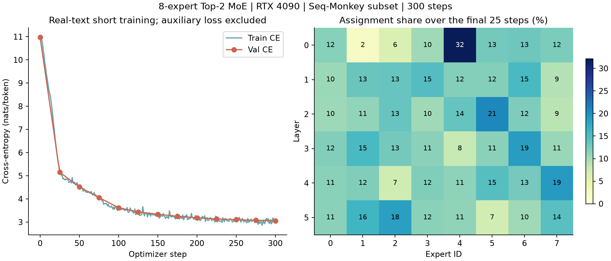

# MoE 文本训练与训练后路由补测

2026-11-01，RTX 4090 24 GB，PyTorch 2.8.0+cu128。使用原有第二篇模型和训练器，不改原始计时记录，不将本轮训练速度与 PyTorch 2.7 首轮数据混作受控后端对比。

## 配置和结果

6 层、隐藏维 768、12 heads，8 个路由专家、Top-2，专家中间维 512，无共享专家，不设容量截断、不丢 token，148,038,912 参数。Dense Attention 使用 math 后端，专家计算为逐专家 gather / index_add，无 fused/grouped GEMM。

沿用同一 Seq-Monkey 子集的文档划分和 token 文件。B=12、S=512，300 步、1,843,200 token，每 25 步在固定 192 个验证块评估一次。FP32 权重/AdamW，BF16 AMP，dropout=0，负载均衡辅助权重 0.01。图与验证值只展示交叉熵，不含辅助损失。

| 指标 | 值 |
| --- | ---: |
| 初始验证交叉熵 | 10.973834 |
| 第300步验证交叉熵 | 3.060615 |
| 最后25步训练交叉熵均值 | 3.021024 |
| 跳过前10步后模型步中位数 | 134.736 ms |
| 训练循环含验证保存 | 68.301 s |
| 峰值 allocated 显存 | 9,561,131,520 bytes |



日志有 300 条训练和 13 条验证记录，每层每步的 assignment 总数为 B×S×2。热图按最后 25 步聚合后归一化，不代表专家语义、长期负载或已经取得完全均衡。短程训练不构成充分预训练或架构质量匹配。

## 训练后精度检查

使用保存的最佳权重和同一验证 token 文件的前 256 token，比较完整前向和 127/1/128 分块静态缓存前向，不强制任何专家选择。

| 精度 | logits最大绝对差 | 相对L2 | 层内token选择变化数 | 原容差通过 |
| --- | ---: | ---: | ---: | --- |
| FP32 | 8.58e-6 | 1.80e-7 | 0 | 是 |
| 原生 BF16 | 0.4375 | 0.003143 | 6 | 否 |
| FP32权重 BF16 autocast | 0.4375 | 0.003410 | 10 | 否 |
| 原生 BF16 FP32 router | 0.4375 | 0.002976 | 7 | 否 |

选择变化跨层累加，不能说成去重后的 token 数。保留原始误差、变化位置和 full 路径的选择边界间隔，不放宽容差。这里只观察到路由变化与误差并存，没有做强制选择重放来隔离全部因果。样本只有一段，不能据此描述全数据分布或给出泛化误差界。

## 复跑与保存

```bash
python -m tools.chapter02.run train --device cuda --dtype bfloat16 \
  --preset teaching --variant moe --backend math --data /path/to/subset \
  --batch 12 --context 512 --steps 300 --eval-every 25 --eval-blocks 192 \
  --save-checkpoint --output runs/moe-text-new
python -m tools.chapter02.check_trained_moe --checkpoint runs/moe-text-new/best-model.pt \
  --data /path/to/subset --output runs/moe-trained-check-new
```

原始数据和权重位于本地 `runs/rtx4090-20261025/train-moe-300-extra/`，检查位于 `trained-moe-check-extra/`。可公开日志位于 `data/chapter02/moe-text-20261101/`。最佳权重不含优化器/RNG，不能精确断点续训。

权重 SHA256 与服务器原件一致：`d51f6b3d80249d7f9efcafee6ec665b936a04681c1a2d1a907c0c0269c019e87`。环境、初始权重与数据指纹随日志保留。完整数据和虚拟环境二进制不随 Git 分发。
