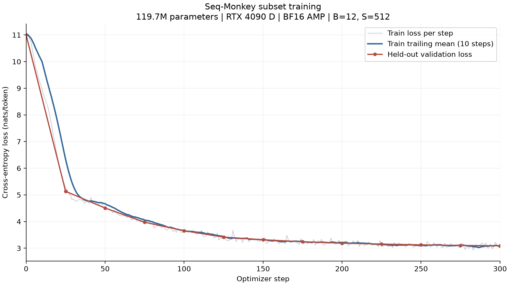

# Seq-Monkey 中文子集 300 步训练记录

日期：2026-10-25。模型结构与文章保持一致，119,690,496 参数，6 层、H=768、12 head、SwiGLU I=2048，词表 50257，不共享 Embedding/LM Head 权重。使用同一 Notebook 的模型定义，在进程内修正相邻配对 RoPE 的频率排列，不改原文件。



## 数据来源与划分

- 原发布方：[出门问问 Seq-Monkey](https://github.com/mobvoi/seq-monkey-data)。[中文预训练语料说明](https://github.com/mobvoi/seq-monkey-data/blob/main/docs/pretrain_open_corpus.md)。原发布方将文本集标注为 Apache-2.0。
- 实际下载源：[ModelScope 第三方镜像 ddzhu123/seq-monkey](https://modelscope.cn/datasets/ddzhu123/seq-monkey)，请求固定 revision `63aa0850487f8ea5f99abe57f47797ba83c090b5`。
- 压缩包 `mobvoi_seq_monkey_general_open_corpus.jsonl.tar.bz2`，镜像元数据大小为 11,356,716,280 字节。本次流式解压，只取有限文档，不保存完整压缩包，因此没有校验完整包的官方 MD5 或镜像 SHA256，不声称已经验证全量一致性。
- 先做 NFC、换行与首尾空白规范化，去除全部空白后计算 SHA256 用于重复识别；少于 100 字符或 32 token 的文本跳过。
- 文档哈希的前 16 个十六进制位转整数，模 20 为 0 的进入验证集，其余进入训练集。重复文档在划分前跳过，训练/验证文档哈希交集为空。
- 每文档最多取 8192 token，追加 EOT=50256。两组独立拼接为 token 流，输入块长度 512；同组内 Attention 可以跨 EOT 看到前一文档，未引入文档隔离 mask。
- 顺序读取压缩包中的首批合格文档，不是全库随机样本；未进行近似去重，不能保证不存在同源改写或近似重复。

最终训练集 2282 篇、4,259,581 token，验证集 114 篇、203,545 token。完整划分规则、摘要和预处理脚本指纹见 [manifest](../data/seq-monkey-300/manifest.json)。分词器是 GPT-2，使用官方 encoder.json/vocab.bpe，并核对两个文件的官方 SHA256；未训练新的中文 tokenizer。

## 训练设置

- RTX 4090 D，PyTorch 2.7.0+cu128，CUDA Runtime 12.8，TF32 关闭，CPU 线程数 4。
- FP32 权重和优化器状态，BF16 autocast；不使用 GradScaler，不使用 compile/SDPA 等优化。
- 随机种子 1024，B=12，S=512，dropout=0.1，累计 300 次 optimizer update，每次 6144 个 token。
- AdamW，weight_decay=0.01，梯度范数裁剪 1.0；前 20 步线性 warmup 到 3e-4，随后 cosine 降到 3e-5。
- 训练块无放回随机打乱；当前 300 步未耗尽一个 epoch，没有重复遍历全部训练集。
- 验证集用独立种子 2026 固定抽取 192 个块，基线及每 25 步各评估一次，单次共 98,304 token；共 13 次验证。验证数据不用于反向传播，但用于选择最佳权重；没有额外独立测试集。
- 每步检查 loss 有限，裁剪时对非有限梯度范数报错。实际日志中未发生此类失败。

逐步训练 loss 是更新前、开启 dropout 的当批 loss；验证 loss 是相应步更新后、关闭 dropout 的固定验证块平均值。图中平滑线是包含当前点的 10 步尾随均值，灰线保留原始波动。验证标记间的直线不是额外测量点。

## 结果

| 指标 | 实测 |
| --- | --- |
| 初始验证 Loss | 10.99766 |
| 第 300 步验证 Loss | 3.09136 |
| 最后 25 步平均训练 Loss | 3.07212 |
| 第 300 步训练 Loss | 3.01593 |
| 累计训练 token | 1,843,200 |
| 跳过前 10 步后的单步中位时间 | 0.24433 秒 |
| 对应训练吞吐 | 25,146 token/s |
| 训练循环含验证与保存的时间 | 106.61 秒 |
| Peak allocated | 9.844 GiB |
| Peak reserved | 11.447 GiB |

吞吐按每步含输入搬运、前向、反向、裁剪、更新和同步的时间计算，不含周期性验证与保存。循环总时间不含模型初始化、语料下载预处理和第 0 步基线验证，不能当作从零到完成的全部墙钟时间。显存数值是 PyTorch allocator 统计，不等同于 nvidia-smi 设备总占用。

两组 Loss 均下降，表明在这些未参与梯度更新的验证块上也有改善。但 300 步仅处理约 184 万 token，不是充分训练；GPT-2 的中文分词包含字节级结构，Loss 降低不等同于语义能力或可用对话质量。该曲线不支持与不同 tokenizer/语料下的其他模型直接比较，也不能排除近似重复导致的偏乐观。

## 文件与复现

- [逐步日志](../data/seq-monkey-300/metrics.jsonl)：300 个 train 记录、13 个 val 记录。
- [训练配置](../data/seq-monkey-300/config.json)：模型、训练参数、源 Notebook/脚本/数据指纹。
- [结果摘要](../data/seq-monkey-300/summary.json)。
- [预处理脚本](../tools/prepare_seq_monkey.py)、[训练脚本](../tools/train_seq_monkey.py)、[绘图脚本](../tools/plot_training.py)。

自行提供可信的 Notebook 及官方 GPT-2 tokenizer 文件，在相应 CUDA 环境中执行：

```bash
python tools/prepare_seq_monkey.py --tokenizer-dir /path/to/gpt2-tokenizer --output /path/to/subset
python tools/train_seq_monkey.py /path/to/build_gpt.ipynb \
  --data /path/to/subset --output /path/to/run-300 --steps 300
python tools/plot_training.py /path/to/run-300/metrics.jsonl --output /path/to/loss.png
```

Python 依赖为 torch、numpy、requests、tiktoken、matplotlib。新实验使用空输出目录，不覆盖已有日志。最佳模型权重保留在实验服务器；checkpoint 包含模型、配置、step 与验证值，没有优化器和 RNG 状态，因此不是可精确续训的完整 checkpoint。仓库不分发语料正文、token bin、tokenizer 文件和权重。
