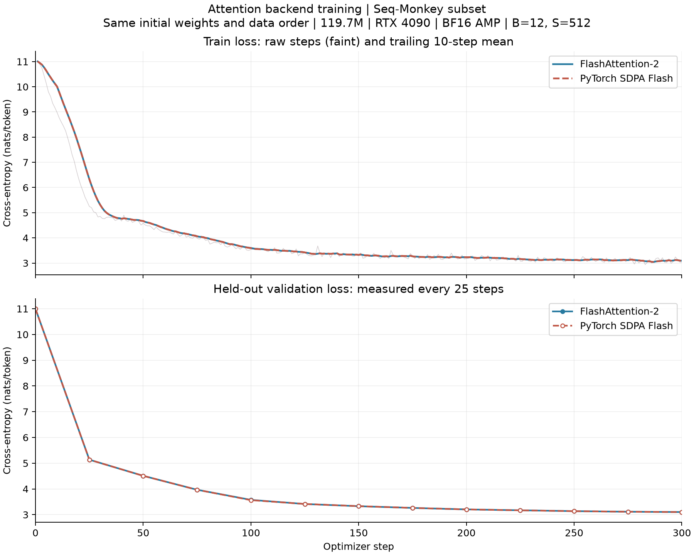

# FA2 与 SDPA Flash：真实语料训练曲线

2026 年 10 月 25 日，在 RTX 4090 24GB 上分别完成了 FlashAttention-2 和 PyTorch SDPA Flash 的 300 步训练。这里不再是固定随机 token 的训练步骤计时，而是第一篇所用 Seq-Monkey 中文子集上的训练与验证。



两组曲线很接近，图中以实线和虚线区分。上图淡线是每步原始训练 Loss，粗线是包含当前点的 10 步尾随均值；下图只在实际验证的 13 个位置绘制标记，点间连线不代表额外测量。

## 如何保持可比

使用第一篇的原始 Notebook 定义，在内存中修正 RoPE 的频率排列；没有改写原文件，也没有换成第二篇重新组织参数的模型。新增适配器保留各 head 的 Q/K/V 投影、参数名称、初始化、输出投影和 dropout，只将投影结果堆成多头张量后，交给指定的 Attention 后端。训练不使用 KV Cache。

- 参数量 119,690,496，6 层、宽度 768、12 heads、SwiGLU 中间维 2048、词表 50257。
- PyTorch `2.7.0+cu128`，独立 FA2 为 `flash-attn==2.8.3`；SDPA 显式限定 `FLASH_ATTENTION`，不允许静默切到 math 后端。
- FP32 权重与 AdamW 状态、BF16 autocast，dropout=0.1，B=12，S=512。
- 随机种子 1024，前 20 步线性 warmup 到 3e-4，随后 cosine 降至 3e-5；weight decay=0.01，梯度范数裁剪 1.0。
- 相同的训练块排列与固定的 192 个验证块，基线及每 25 步验证一次；每次验证 98,304 token，不用于反向更新。
- 两次运行记录的初始参数 SHA256、训练顺序 SHA256、验证块 ID、语料 token 文件 SHA256 均相同。绘图脚本检查这些字段和日志完整性，配置不匹配或记录缺失时直接报错。

本次重新流式准备有限语料子集，训练集 4,259,581 token、验证集 203,545 token，两份文件的 SHA256 都与第一篇记录相同。来源、文档级划分、GPT-2 分词器、近似重复和抽样局限仍见[第一篇训练记录](seq-monkey-300.md)。

同一个随机种子不保证不同 kernel 采用相同的 dropout 掩码，BF16 的运算次序也会产生舍入差异。因此不能要求两个后端训练后权重完全相同，更不能从几千分之一的最终 Loss 差异判断谁的训练质量更好。

## 实测结果

| 指标 | FA2 | SDPA Flash |
| --- | ---: | ---: |
| 初始验证 Loss | 10.99762 | 10.99763 |
| 第 300 步验证 Loss | 3.10220 | 3.10086 |
| 最后 25 步平均训练 Loss | 3.08631 | 3.08514 |
| 累计训练 token | 1,843,200 | 1,843,200 |
| 跳过前 10 步后单步中位时间 | 0.14954 秒 | 0.14982 秒 |
| 训练循环含验证与保存 | 67.14 秒 | 66.47 秒 |

训练每步都检查 Loss 与裁剪前梯度范数是否有限，两组均正常完成。单步计时包括取 batch、H2D、前向、反向、裁剪和参数更新，周期性验证与保存不计入单步时间；完整循环时间另列。不锁 GPU 频率，这里不把小幅耗时差异解释为稳定的性能优势。

第一篇原始逐 head Attention 的最终验证 Loss 为 3.09136。它是在另一张 RTX 4090 D 上测得的，且 dropout 执行路径不同，可以参照学习趋势，不能直接作为本轮后端速度对照。这里两组采用相同的旧模型投影路径，也不要与第二篇合并 Q/K/V 投影的计时表混为一谈。

结论限定为：**FA2 和 SDPA Flash 都已完成这份模型的真实语料短程训练，训练与验证 Loss 均下降，趋势相近。** 300 步仍不是充分预训练，不代表语言能力评估，也不是多次随机种子实验下的统计等价证明。FA4 没有包含在这次训练中。

## 日志与配图

- [FA2 配置、逐步日志、环境与结果](../data/seq-monkey-attention-300/fa2/)。
- [SDPA Flash 配置、逐步日志、环境与结果](../data/seq-monkey-attention-300/sdpa-flash/)。
- [本地完整性检查](../data/seq-monkey-attention-300/verification.json)：核对训练/验证记录数、共同初始化、数据指纹、归档源码及权重张量的有限性。
- [FA2 单独曲线](../articles/images/llm-attention/seq-monkey-fa2-loss.png)。
- [SDPA Flash 单独曲线](../articles/images/llm-attention/seq-monkey-sdpa-flash-loss.png)。
- [训练入口](../tools/train_seq_monkey.py)、[后端适配器](../tools/chapter02/notebook_adapter.py)、[对照绘图脚本](../tools/plot_backend_training.py)。

在对应 CUDA 环境下，提供可信的原始 Notebook 和已准备的语料目录：

```bash
python tools/train_seq_monkey.py /path/to/build_gpt.ipynb \
  --data /path/to/subset --backend fa2 --steps 300 \
  --batch 12 --sequence 512 --eval-every 25 --eval-batches 16 \
  --output /path/to/run-fa2
python tools/train_seq_monkey.py /path/to/build_gpt.ipynb \
  --data /path/to/subset --backend sdpa-flash --steps 300 \
  --batch 12 --sequence 512 --eval-every 25 --eval-batches 16 \
  --output /path/to/run-sdpa-flash
python tools/plot_backend_training.py /path/to/run-fa2 /path/to/run-sdpa-flash \
  --output /path/to/backend-loss.png
```

必须使用新的空输出目录。最佳权重包含模型、配置、step 和验证值，不包含优化器与 RNG 状态，不能用于精确断点续训。

## 本地归档

Mac 上的完整原始实验位于 `runs/rtx4090-20261025/`，不随 Git 上传：

- `seq-monkey-fa2-300/` 与 `seq-monkey-sdpa-flash-300/`：两次训练的配置、逐步日志、环境、摘要和 `best-model.pt`。
- `datasets/seq-monkey-first-subset/`：本次实际使用的 train/val token 文件、选中文档正文与 manifest。
- `ch02-complete-recovery-20261025.tar.gz`：远端实验目录的代码、原始 Notebook、依赖清单、tokenizer、数据子集、所有运行记录和 Profiler trace。排除了虚拟环境、缓存和权重；两份正式训练权重另外保存在对应运行目录。
- `server-snapshot/`：上述归档已经解压，源码、数据与 trace 可以直接查看。

归档 SHA256：`240fde4d8abc240a4d81823ba29626fc204ecb165257d51628161d547c2f600e`。

FA2 权重 SHA256：`c5ddb221f0dc2ca691bf3639f7436ccb1180ac790aa89c8b4d5b24f42ef1d18f`。

SDPA Flash 权重 SHA256：`63d9bfa9c5c917fac6096dd55b2889bd5d3edc001dd15aa7009f918348f0c741`。

本地代码与归档足以保留本次实验输入和结果；不将虚拟环境打包等同于可以脱离 CUDA/驱动重新运行。
